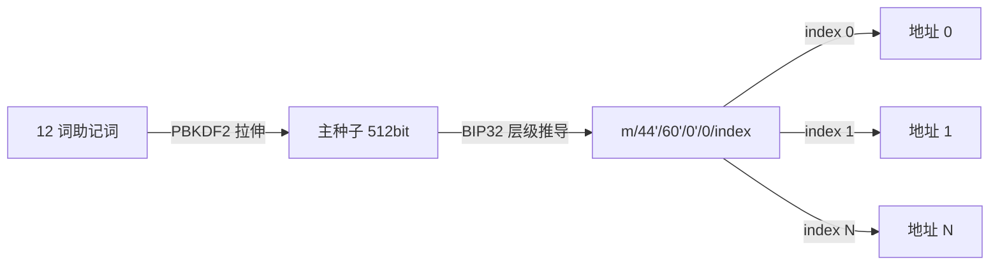

# Phase 3 讲义：区块链原理与链上充值监控（第 8-9 周）

> 与基线一致：`../roadmap.md` 第 3 节 Phase 3（W8-9）、第 9 节 P1 项目、第 8 节系统设计题②「充值确认与安全」；术语按 `../CLAUDE.md` 第 1 节。
> 本阶段产出：**P1 链上充值监控服务**（`../projects/p1-deposit-watcher/SPEC.md`）。它直接喂养系统设计题②，并是 P2 钱包模块的前置。
> 读法：W8 是原理周（面向后端工程师，不是合约开发者），W9 是项目周；与 `tasks.md`、`checklist.md` 按日对照执行。
> 铁律：本讲义不给完整实现代码，只给概念、接口签名与伪代码要点；完整代码由你写。违反它 = checklist 第 4-9 条做不到。

## 第 8 周：区块链后端必备原理

### 1. 交易生命周期（transaction lifecycle）

**直觉**：一笔充值从你点「发送」到交易所入账，是一条七站的旅程，每一站都可能停留或失败。后端工程师要能说出「这笔钱现在在哪一站」。

1. 构建（build）：组装 from/to/value/gas 字段，得到未签名的 raw transaction。
2. 签名（sign）：用私钥签名（secp256k1，见第 2 节）。
3. 广播（broadcast）：把签名交易发给任意一个节点。
4. 进入 mempool：节点验证后放进待打包池。**广播成功 ≠ 交易成功**。
5. 打包（inclusion）：矿工/验证者把交易放进一个 block，区块经共识广播。
6. 确认（confirmation）：该 block 之后每加一个块，确认数（confirmations）+1。
7. 最终性（finality）：以太坊共识最终确定后，理论上不可逆。

**交易所场景对应**：充值延迟的 90% 发生在「广播 → 打包」之间（gas 给低了会等很久）；你的监控服务对「已广播未确认」的刻画就是 pending 状态。系统设计题②考「如何确认一笔充值」，考的就是第 5-7 站。

### 2. 密钥与地址（ECDSA / secp256k1）

**直觉**：椭圆曲线签名是「单向门」——从私钥算公钥很容易，反推在计算上不可行。你不需要懂曲线数学，只需要懂推导链与「私钥 = 全部」这句铁律。

推导链（概念级，不深挖数学）：

```
私钥（256 bit 随机数）→ 椭圆曲线点乘（secp256k1）→ 公钥（64 字节）
  → keccak256 哈希 → 取后 20 字节 → 地址（0x + 40 个十六进制字符）
```

关键接口（go-ethereum 现成可用，不需要自己实现数学）：
```go
func crypto.HexToECDSA(hexKey string) (*ecdsa.PrivateKey, error)
func crypto.PubkeyToAddress(pub ecdsa.PublicKey) common.Address
```

参考实现要点：私钥只存在于内存与加密存储；地址有 EIP-55 校验和写法（大小写混合）。本项目全程只读链，不需要任何密钥。

常见坑与排查：把私钥写进配置、打进 git 或日志 = 资金风险，面试必挂；「地址是怎么生成的」是三分钟能讲清的白板题（推导链就是答案）。

**交易所场景对应**：交易所给每个用户派生独立充值地址（deposit address），才能把链上转账归因到用户——「地址即用户 ID」。

### 3. HD 钱包 BIP32/39/44

**直觉**：一个助记词（seed phrase，12 个英文词）是一棵树的种子，可以派生无限个子地址，且从任意子地址无法反推兄弟地址。



- BIP39 定义助记词 → 种子（PBKDF2）。
- BIP32 定义从种子分层推导子私钥（HD 树）。
- BIP44 定义用途分层：`m/44'/60'/0'/0/index` = BIP44 前缀 / coin type 60'（Ethereum）/ 账户集 0' / 序号 index。带 `'` 是 hardened derivation，隔离更强。

关键接口（go-ethereum `accounts/hd` 包）：
```go
var hd.DefaultIterator   // 按序迭代派生路径
func hd.Derive(path accounts.DerivationPath, prv *ecdsa.PrivateKey) (*ecdsa.PrivateKey, error)
```

参考实现要点：主种子 + 递增 index 就是「给无数用户发地址」的机制；MetaMask 的第 0/1 个账户即 index 0/1。

**交易所场景对应**：交易所热钱包就是一个 HD 根；为用户派地址只消耗一个 index 整数，不逐用户保存私钥。P2 钱包模块直接复用这套派生（提现/归集地址管理）。

### 4. EIP-1559 gas 机制

**直觉**：网络忙时交易竞价（拍卖）：价高者先被打包。EIP-1559 把价格拆成两部分：

- baseFee：全网统一「通行费」，随区块负载自动调节（每个区块最多 ±12.5%，父块使用率 >50% 上浮、<50% 下浮）。**这部分被销毁（burn）**，不进矿工口袋。
- priorityFee：你付给打包者的「插队小费」。

然后 `effectiveGasPrice = baseFee + priorityFee`；总费用 ≈ `gasUsed × effectiveGasPrice`。

为什么后端要知道：①gas 给低了交易会挂在 mempool 几小时——你要能读出交易的 gas 花费来排查「这笔充值怎么还没确认」；②**EVM 里 revert 的交易不落事件日志**——失败的交易不会留下 Transfer 日志，「读日志入账」因此天然免疫失败交易（注意：某些 EVM 兼容链对失败交易日志行为不同，这是对账兜底存在的理由之一）。

常见坑与排查：钱包显示的「gas 费」是估算值，实际以 receipt 的 `actualGasUsed` 为准；余额扣减用 `gasPrice` 而非 `gasLimit`。

**交易所场景对应**：提现签名时 gas 估低了 → 提现单挂 mempool 几小时，用户投诉「提现卡住」；交易所提现费率模型要把这部分成本折进去。

### 5. EVM 执行与事件日志（event log）—— 充值解析的核心

**直觉**：事件日志是合约「广播出去的便签」：只有合约自己 emit 的才算数、可按地址与 topic 检索。充值监控 = 在链上找 USDC 合约广播的「谁转给谁多少钱」。

一条 log 的结构（这是本阶段最重要的一个框）：
```
log = address(合约地址) + topics[0..3] + data + blockNumber + transactionIndex + logIndex
  topics[0] = keccak256("Transfer(address,address,uint256)")   ← 事件签名哈希，恒在第 0 位
  topics[1] = from  （indexed → 进 topics，32 字节左补零）
  topics[2] = to    （indexed → 进 topics，32 字节左补零）
  data      = value（uint256，非 indexed → 进 data，ABI 编码）
```
规则：**indexed 参数进 topics[1..3]（最多 4 个 topic 含签名），非 indexed 参数进 data**。logIndex = 该 log 在区块内的序号，与 (blockNumber, transactionIndex) 一起唯一定位「某一笔交易的某一笔事件」——幂等键的由来。

关键接口（go-ethereum rpc 客户端）：
```go
q := ethereum.FilterQuery{FromBlock: big.NewInt(n), ToBlock: big.NewInt(m),
    Addresses: []common.Address{usdcAddr}, Topics: [][]common.Hash{{transferTopic}}}
logs, err := client.FilterLogs(ctx, q)                    // 返回 []types.Log
sub, err := client.SubscribeFilterLogs(ctx, q, ch)        // WebSocket 订阅
```

参考实现要点：解析器 = 把 topics[1]/topics[2] 转 `common.Address`、data 按定长 `big.Int` 读取；写成纯函数（输入 `types.Log` → 输出你定义的结构），单测用手工构造的 Log 喂。

常见坑与排查：①**USDC 是 6 位小数**，raw value 除以 1e6 才是人看的金额（读到的 1000000 = 1 USDC）；②topics 里的地址是 32 字节左补零，直接转 string 会得到一坨零；③sepolia.etherscan.io 的 Logs 页签是调试第一对照物。

**交易所场景对应**：充值解析只有这一条输入通道；幂等键 = (txHash, logIndex, 接收地址) 三元组（理由见第 7 节）。

### 6. 确认数与重组（confirmations & reorg）

**直觉**：链是树不是线——同一时刻可能存在两个合法分叉。你的交易在分叉 A 被打包，但分叉 B 赢了，交易就消失或换了位置。这就是重组（reorg）。

- **为什么是 6 个确认**：攻击者要撤销一笔收入，必须在分叉上追出更多块。每多一个确认，被追上的概率呈指数下降，6 个确认后小到可忽略。这是成本-安全的工程权衡（大额充值给更多确认）。
- **reorg 时发生什么**：轻则一笔交易确认数回退，重则「已入账的充值」在新链上不存在——系统必须能撤销之前的入账，术语叫冲正（reversal）。
- **状态机三态**（课程术语表统一）：pending（未达门槛）→ confirmed（≥6 确认）→ finalized（达到共识最终性，以太坊 PoS 约 2 个 epoch）；冲正从 pending/confirmed 退到 reversed。

```
pending → confirmed → finalized
pending → reversed        （reorg 掉 / 从未进主链）
confirmed → reversed      （已确认后出现更深层 reorg）
```

**交易所场景对应**：冲正是充值业务最大的资金风险——「币到账了、用户提走了、reorg 把这笔充值撤了」。交易所的应对 = 确认数门槛 + 冲正。系统设计题②的完整答案 = 幂等入账 + 状态机 + 冲正。

### 7. 节点 RPC 面（node RPC surface）

| 方法 | 用途 | 注意 |
|---|---|---|
| eth_blockNumber | 当前高度 | 轮询心跳 |
| eth_getBlockByNumber | 取块（含 hash） | 记 hash 供 reorg 检测 |
| eth_getLogs | 按范围取日志 | **有 limit 限制**，见下 |
| eth_getTransactionReceipt | 单笔回执 | 含 status / logs / gasUsed |
| eth_subscribe（WS） | 订阅 newHeads / logs | 断线即漏，不可单独依赖 |

**limit 与分页**：公共 RPC 对 eth_getLogs 单次返回有数量/跨度限制，超限报错。正确姿势是「快照式扫块」：游标只推进到自己已完整消费的块，一批扫不完就缩小范围重试，**永不跳块**。

**轮询为主、订阅为辅**：P1 冻结决策 = 轮询扫块（eth_getLogs）为主。真实交易所的扫块器也以轮询为主，订阅只做加速——因为订阅断线会静默丢事件，而钱的事不能靠概率。

关键接口：`client.BlockNumber(ctx)`、`client.HeaderByNumber(ctx, nil)`、`client.FilterLogs(ctx, q)`、`client.TransactionReceipt(ctx, hash)`。

**交易所场景对应**：不跑自有全节点时，公共 RPC 的限流/限额就是你的 SLA 上界——限流重试+退避不能偷工，这是生产扫块器通用技能。

### 8. 索引器扫块安全边界（block-scanning safety）

扫块器有四个「死法」，每个对应一条必须落地的约束：

1. **扫头块（tip）**：最新块随时会被 reorg，扫了即可能错。约束：落后头块 ≥1 块（tip-lag），配置化，默认 1。
2. **半块（partial block）**：一个区块的日志没取全就推进游标。约束：一个区块的全部日志在同一个数据库事务内落库，事务提交后才推进游标。
3. **游标漂移**：写日志与推游标分离 → 崩溃后重复或丢失。约束：游标与日志同事务；游标表存 (blockNumber, blockHash)，恢复时先对 hash。
4. **从 0 重建**：全量重扫无限历史。约束：重建从 finality 之上的安全高度开始，只重扫「可能变化」的尾部区间。

游标表要点（完整建表见 SPEC 第 6 节）：`scan_cursor: chain_id PK, last_block_number, last_block_hash, updated_at`。

参考实现要点（伪代码）：逐循环 = 读游标 → 目标块 = 游标+1 → 若 target ≥ (头块 - tip-lag) 则睡眠重试 → FilterLogs → 解析 → 事务落库（含游标）→ 更新内存高度。每次失败记录滞留位置，退出不丢游标。

**交易所场景对应**：这四个边界就是系统设计题②的「扫块器设计」得分点。P2 钱包模块直接迁移这套逻辑——P1 把它写成独立包 `internal/scanner` 的原因。

### 9. Solidity 101 前十课导读

**目标**：能读懂合约与事件（扫块要对着 ABI 解析），不是写产品（写产品是 Phase 5 的事）。

用 WTF Academy 中文版 Solidity 101 按此索引读：第 1-3 课（HelloWeb3 / 变量类型 / 函数可见性）精读——address、uint、mapping、event 声明与 emit 必须会看；第 4-10 课（运算符 / 常量 / 控制流 / 数组与结构体 / 修饰符 / 构造函数 / 错误处理）快读，会认即可，逐课写一行「这课讲什么、我干嘛要知道」的产出型笔记。

读事件的五步法（重复用到成为直觉）：
1. sepolia.etherscan.io 打开交易 → Logs 页签，看原始 topics/data。
2. 在合约 ABI 里找到事件签名 `Transfer(address,address,uint256)`。
3. keccak256 该签名 → 与 topics[0] 对照（T-04 手工验证一次）。
4. 按签名把 topics[1..] 与 data 映射回参数名。
5. 换算成人话（USDC 除以 1e6）。

**交易所场景对应**：这是「钱包开发岗」日面工作的原样复刻——读他人的合约事件，解析成自己的账务输入。DeFi 八股在 Phase 5 补，本阶段不需要。

## 第 9 周：P1 项目周

### 10. 上下文与脚手架使用

第 9 周没有新原理，只有执行。脚手架 `../scaffolds/ws-gateway.md` 在 M4 按需取用（只取接口签名 + 目录 + 消息协议，实现自己写）。

项目目录骨架（M1 第一天上手）：
```
cmd/scanner/main.go     # 扫块器入口（装配）
cmd/server/main.go      # 入账/API 入口（装配）
internal/scanner/       # RPC 封装、游标、扫块循环、解析器（P2 复用包）
internal/processor/     # 状态机、幂等入账
internal/handler/       # REST + WS 升级处理
internal/store/         # MySQL 接口与实现
migrations/             # 建表 SQL
```

跑通优先的 P1 路线（对应 10 条验收⑥）：先打一条假链路——任何钱包向你的 deposit address 转测试币 → 扫块器日志打出解析结果 → 数据库一行 → WS 帧 → React 面板可见。链路通了再补 reorg、补测试、补文档；反例是花 3 天打磨扫块性能而链路未通。

### 11. P1 SPEC 导读（`../projects/p1-deposit-watcher/SPEC.md`）

五个里程碑就是两周的工作分解：M1 扫块与事件解析（W8 项目块 + W9D1）→ M2 状态机与幂等入账（W9D2）→ M3 确认数与 reorg 冲正（W9D3）→ M4 通知/API/React（W9D4-5）→ M5 验收（W9D6-周日）。

开工前必须读懂三个设计决策（面试必问）：
1. **幂等键 = (txHash, logIndex, 接收地址)**：重复投递、扫块重执行、Kafka 重放都只能入账一次——落在 deposits 表唯一约束上，数据库兜底，不靠应用层判断。
2. **状态机在「数据」上，不在「内存」上**：deposits 表的 status 是唯一真相，重启不丢；每次扫块 / 确认数更新都走受控迁移。
3. **扫块与入账解耦**：扫块器只把「区块变成事件」，入账服务消费事件——这是 P2 复用扫块器的前提，也是 Kafka 解耦拓扑（下单→撮合→账务）在此的预演。

与 P2 的关系：`internal/scanner` 包在 P2 钱包模块原样迁移（充提需要同样的扫块/确认数/reorg 冲正），所以本项目扫块必须是独立包 + 独立单测，不许与入账代码互相 import 绕圈。

### 12. 演示与验收指引

- 录屏四幕（分镜全文在 SPEC 第 10 节）：启动 → 真实 Sepolia 充值 → 幂等/reorg 特写 → 测试与 CI 数字收尾；3-10 分钟，含讲解。
- 验收 = `../standards/project-acceptance-10.md` 10 条全勾，README 内嵌勾选表。重点项：Sepolia 真实充值录屏（⑤⑥）、状态机迁移测试覆盖率（①）、reorg 冲正演示（③⑥）。
- 复盘（⑨）在结束前写：≥3 个坑 + ≥2 个取舍，每个可改写成 2 分钟面试故事。

**阶段收尾**：对照 `checklist.md` 逐条勾选，缺什么证据补什么证据；全「是」后在 `QA/review-log.md` 留 P1 验收记录。