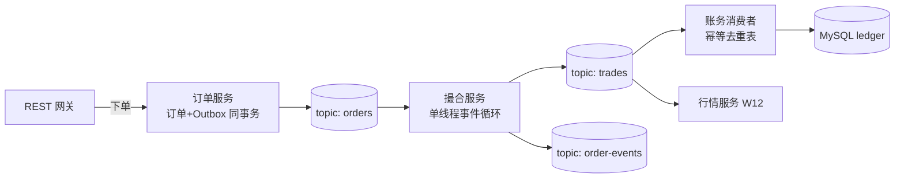

# Phase 4 旗舰 P2 迷你交易所讲义（第 10-14 周）

> 本阶段对应 roadmap.md 第 3 节 Phase 4 的五个里程碑：M1 撮合（W10）→ M2 账务（W11）→ M3 行情 WS（W12）→ M4 钱包+对账（W13）→ M5 前端+压测（W14）。项目规格以 `../projects/p2-mini-exchange/SPEC.md` 为准；WS 网关协议复用 `../scaffolds/ws-gateway.md`（Phase 3 交付）；docker-compose / CI / k6 脚手架复用 `../scaffolds/`（Phase 2 交付）。
>
> 读者画像：JS/TS+React 熟练、无后端经验。本讲义先给直觉再给定义；不给完整实现，只给接口签名、伪代码要点、测试期望与坑。每条指令都要回答「它为什么长这样」，因为面试被追问的就是这里。
>
> 总目标（系统设计题①④⑤⑥⑦的实战载体）：跑一个能「真实充值 → 下单 → 撮合 → 入账 → 行情推送 → 提现回执」闭环的迷你交易所，且每一个环节都留得下证据（截图/日志/录屏）。

---

## W10 撮合引擎（M1）

### 10.1 订单领域模型

**直觉**：订单是「一条有出价方的意图」。撮合引擎只回答一个问题：这条意图现在是否与另一条意图匹配？为此它必须完整描述意图：谁、往哪边、什么价、多少量、多「急」（立刻成交还是挂着等）。

**定义**（先术语后字段）：

- 方向（Side）：买盘 bid / 卖盘 ask。深度图买盘在左、卖盘在右。
- 订单类型（OrderType）：限价单（Limit，指定价格）与市价单（Market，不指定价格、按对手最优价成交）。可选进阶：IOC（立即成交否则取消剩余）/ FOK（全部成交否则整单取消）。本课程 GTC（一直挂单）为默认。
- clientOrderId：客户端幂等键。用户重复点「提交」两次，服务端看到相同 clientOrderId 必须只受理一次——这就是「充值幂等」的同一种思维（见 W11）。
- 数量与价格一律用**定点整数**（int64，缩放因子见 W11 精度节），禁止 float。

**关键接口签名**（撮合包 `pkg/matching`，你的实现必须与之一致）：

```go
type Side uint8      // SideBuy / SideSell
type OrderType uint8 // TypeLimit / TypeMarket
type TIF uint8       // TIFGTC / TIFIOC / TIF_FOK
type OrderStatus uint8 // New / PartiallyFilled / Filled / Canceled / Rejected

type Order struct {
    OrderID, ClientOrderID, UserID, Symbol string
    Side Side; Type OrderType; TIF TIF
    Price, Quantity, FilledQty int64
    Status OrderStatus; Seq uint64 // 事件序号，WAL 回放排序依据
}
type Trade struct {
    TradeID, Symbol string; Price, Quantity int64
    TakerOrderID, MakerOrderID string; TakerSide Side
    Seq, Ts int64
}
func (ob *OrderBook) Add(o *Order) (*MatchResult, error)
func (ob *OrderBook) Cancel(orderID string) (*CancelResult, error)
func (ob *OrderBook) Depth(limit int) *DepthSnapshot // 供行情服务拉快照
```

**测试期望**：缺边/缺量/价格非法的单返回明确的拒绝原因；重复 clientOrderId 第二次到达直接幂等返回已受理的 OrderID，不重新入簿。**交易所场景对应**：Binance 的 `newClientOrderId` 就是 clientOrderId——防「手抖双击」与「重放攻击」靠的是同一把锁。

### 10.2 内存订单簿设计（价格档 → FIFO 队列）

**直觉**：把订单簿想成一个书架。书架按价格分层（档位），每层的人排队（FIFO）。撮合时从「离自己最近的价格」的队头开始吃。核心数据结构就两个：**价格层的有序集合** + **每层一个 FIFO 队列**。

**为什么有序映射 + 队列**：

- 买盘价格按降序排、卖盘升序排，这样「最优价」永远在集合端点，O(log n) 即可取到。
- 红黑树/跳表能在 O(log n) 插入删除档位：为什么不是 Go 原生 map？map 的迭代顺序语义上是随机的，拿不到「最高买价」，更拿不到「次高买价」。为什么不是 slice？中间插入 O(n) 移动。
- Go 标准库没有内置有序映射，三条路线任选：自写 skiplist（推荐，当作练手）、slice + 二分插入（单个 symbol 档位数有限时完全够用）、第三方 btree 库。
- 按 symbol 分片：`map[Symbol]*OrderBook`。不同 symbol 互不相干，天然隔离，也决定了 W10.4 的并发模型。

**参考实现要点**（伪代码）：`book[Symbol] = { bids: 有序层, asks: 有序层 }`；每层 `level = { price int64, queue []*Order }`；`Add` 先查层，层存在则 `append` 队尾，不存在则按序插入新层。

**常见坑与排查**：档位空了忘记删层，导致后续循环白白扫空层；新单插入队列用「队头插入」写反了时间优先。排查手段：单测里用「同价 3 连发」断言成交顺序 = 提交顺序。

### 10.3 撮合规则（price-time priority）

**规则（冻结语义）**：价格优先（更优价先成交）→ 时间优先（同价先到先成交）。taker/maker 定义：主动来撮合的是 taker，簿上被动成交的是 maker。每笔成交记录双方订单：`TakerOrderID / MakerOrderID / TakerSide`——账务与行情都靠这对字段。

**参考实现要点**（伪代码）：

```
doMatch(taker):
  loop:
    opp := opponent(taker.Side)
    if 对手簿空 或 不交叉: break        // 买→卖：bestAsk > taker.Price 则停
    level := opp 最优点层; o := level.queue[0]
    fillQty := min(taker.Remaining, o.Remaining)   // 部分成交
    生成 Trade(price=level.price)，更新双方 FilledQty/Status
    if o 满: level.queue 弹出队头; 空了删层
    if taker 满: break
  // 分类处理尾声：
  Limit+GTC: 剩余入簿；Market: 剩余立即失效（报错或部分成交即收尾）
  IOC: 剩余取消；FOK: 未能全成 → 整单拒绝（不产生任何成交）
```

**自成交防护**：同一 UserID 的买卖单不能互相成交。教学实现：撮合循环中命中同 UserID 对手单时**跳过该单继续向下找**，并记告警日志。面试对照：Binance 等使用「cancel newest」策略——先讲的取舍记入 ADR。

**测试期望**：输入随机化场景 → 每一笔成交 price 等于 maker 挂单价格（taker 吃 maker 的价）；同价 100 笔并发，时间优先严格成立；部分成交后双方剩余量正确。

**交易所场景对应**：你在币安看到的「买一 100 手被瞬间吃完」就是几万行的 doMatch 循环——量级不同，规则相同。

### 10.4 内存撮合的单线程事件循环

**直觉**：订单簿是一份共享状态。多线程访问要加锁，锁 = 排队 + 上下文切换 + 缓存失效。**换个思路：不让它被并发访问**——所有对簿的操作（下单/撤单/查询）都塞进同一个 goroutine 的队列里逐个执行。一个执行者、无锁、天然一致。这正是 LMAX 架构的精髓：单个线程独占热状态，吞吐来自缓存亲和（读的是同一块连续内存、无锁等待）。

**工程实现**：命令 channel `chan Command` + 独立 goroutine 消费；撮合完成把事件发往下游 channel 或直接调用回调（事件循环内不做 IO/网络调用，只做内存操作）。为什么可以这样：单个 symbol 的撮合瓶颈在 CPU 与内存带宽，不在并发——真实交易所的"撮合分片"同样按 symbol 路由到不同的核心。

**对照阅读**：LMAX 文章（马丁·福勒）讲透「单线程为何是性能解药」；exchange-core 是 Java 版单线程撮合的完整参照（只读其算法组织，不看语言细节）；i25959341/orderbook 是 Go 参考。

**常见坑与排查**：把 DB 写入/HTTP 调用放进了事件循环（阻塞即拖垮全号簿吞吐）——事件循环内只做纯内存操作，副作用一律转成事件发出；goroutine 泄漏（撮合 goroutine 无关闭路径）。排查：pprof goroutine 图看数量。

### 10.5 WAL + 快照 + 重启回放

**直觉**：内存里跑得快，但断电全丢。「先记账再干活的账本」叫 WAL：任何指令先追加写到磁盘日志（带全局递增 Seq），成功后才改内存。重启 = 读快照 + 重放快照之后的 WAL。这是数据库 Redo Log 的同款思路（DDIA 第 3 章对照）。

**参考实现要点**：`wal.Append(record{Seq, Kind(NewOrder/Cancel), Payload})`；`fsync` 策略二选一：逐笔刷盘（最安全最慢）或 group commit（攒 5ms 或 1000 条刷一次，吞吐高、崩溃最多丢攒批中的指令——订单语义上可接受，写进 ADR）；快照：每 N 条指令或每 5 分钟把整簿序列化落盘（`snapshot.{seq,n}`）；回放：加载快照后，对 Seq > snapshotSeq 的 WAL 逐条 `Add/Cancel`。WAL 指令必须是**可重复执行的**（幂等，见 10.6 的 Seq 去重）。

**测试期望**：对簿做随机 10000 次操作 → 记录 `Depth()` 指纹 → kill -9 → 重启回放 → 指纹一致；崩溃发生在 WAL 写入中途时不产生坏记录（每行一条记录的设计天然抗截断）。

### 10.6 不变式与性质测试（fuzz）

**直觉**：手写用例覆盖不了「万亿种指令顺序」。性质测试（property-based testing）把不变式写成断言，让 fuzz 引擎随机生成指令流、**每一步之后**都验证不变式。Go 原生 `FuzzXxx` 即可。

**必须断言的不变式**（本阶段核心交付，W11 再补帐务不变式）：

1. 无交叉：任意时刻 bestBid < bestAsk；
2. 同价 FIFO：同价层成交顺序 = 入队顺序；
3. 成交量守恒：Σ(trade.Quantity) == Σ(下单填满量)，且每笔 trade.Quantity > 0；
4. 状态合法：Status 转移只允许 New/PartiallyFilled → Filled/Canceled/Rejected，不允许 Filled 再 Canceled。

**参考实现要点**：`FuzzMatchInvariant(f *testing.F)`：seed corpus 放经典场景（空簿市价、同价挤兑、大单吃透多层）；每轮生成随机指令序列（随机方向/价格/数量/撤单目标），每执行一步跑一遍全部不变式断言；可选加分：写一个朴素参照实现做差分对拍（differential testing）。

**测试期望**：`go test -run FuzzMatchInvariant -fuzz . -fuzztime 30s` 无任何断言失败；CI 上再跑 1000 轮记录数量（验收标准①要求轮数留痕）。

**常见坑与排查**：fuzz 引擎发现崩了就停——先把「最小复现」存进 corpus 修掉再继续；整数溢出（Price×Quantity 超 int64）——用溢出检查或 int128 中间量，并把这类边界值写进 seed corpus。

**交易所场景对应**：这个 200 行的 fuzz 就是真实交易所最贵的测试——撮合 bug 的代价是资金差，不是服务质量差。

---

## W11 账务域（M2）

### 11.1 三栏账户模型（frozen / available / total）

**直觉**：钱一进交易所，就分成「能动」和「不能动」。下单挂单时钱被冻结（已承诺）、撤单解冻、成交转移。三栏即：可用（available）可提可花；冻结（frozen）挂在单上；总额 total = frozen + available。**恒等式是每次入账后都成立**的，把它当成和 10.6 一样的性质测试来写。

**关键接口签名**（账务包 `pkg/ledger`）：

```go
func (l *Ledger) Freeze(userID, asset string, qty int64, ref string, idemKey string) error
func (l *Ledger) Unfreeze(userID, asset string, qty int64, ref string, idemKey string) error
func (l *Ledger) Transfer(fromUser, toUser, asset string, qty int64, ref string, idemKey string) error
func (l *Ledger) Balance(userID, asset string) (available, frozen, total int64, err error)
```

**交易所场景对应**：下单 → 按钮「已冻结」变灰；撤单 → 钱回来。换算：买单占 quote（USDT），卖单占 base（BTC），撮合成交时一生一灭。

### 11.2 复式记账（double-entry bookkeeping）

**直觉**：单式记账好比只记「花了 100」；复式记账强迫你同时记「钱从哪来、去哪了」。任何一笔业务事件都写成 ≥2 条分录，Σdebit == Σcredit 永远成立。**为什么资金系统必须复式**：任何程序员 bug、恶意篡改、并发错序，都会打破借贷平衡——对账任务会发现，而不是无声地错。单式记账的错误是沉默的。

**参考实现要点**：科目（account）设计为三元组 `(userID, asset, bucket)`，bucket ∈ {available, frozen}；每条流水 `journal(id, ts, debitAccount, creditAccount, qty, ref, idemKey)`；同一事务内写流水 + 更新余额（余额可冗余存储，以流水为准）。**先冻结后成交**是纪律：撤单 = 原冻结分录反向；成交 = 冻结减少 + 对手方反映。

**测试期望**：任何业务事件序列后 Σdebit == Σcredit（全局校验脚本）；**单笔**事务要么全成要么全不成（转账中途失败不得留下半笔）。

### 11.3 decimal 定点精度（为什么禁止 float）

**直觉**：0.1 + 0.2 != 0.3（二进制无法精确表示十进制小数）。金额差 1 wei 都是事故。**方案**：所有金额与数量用整数最小单位（per-asset decimals，ERC-20 的 decimals 字段定义它，USDC=6、ETH=18）；内部统一记为一个 int64（如 1e8 缩放），展示层再格式化。**进位规约**：成交金额 = floor(price × qty) 一次算好并作用于双方（taker/maker 谁也不占便宜），取整方向写进文档并加测试。

**常见坑与排查**：JSON 反序列化进来时是字符串（前端传 "100.5"），先解析成定点整数再入系统；int64 乘法溢出（用 `math/bits.Mul64` 检查或先除后乘）；「只在展示层用 float」的诱惑——错误会在展示与核心间产生偏差，一律禁止。

### 11.4 撮合-账务解耦：Kafka 拓扑与 Outbox

**直觉**：撮合要快（内存单线程），账务要可靠（事务+幂等）。两者节奏不同，硬塞一个进程会让彼此拖累。用事件解耦：撮合只产事件，账务异步消费。**为什么 at-least-once + 幂等**：Kafka 只保证至少一次（可能重复），所以「恰好一次」由消费侧自己保证——W11 学的这套就是 Phase 2 种子工程已搭过的 Outbox + 幂等表，这里原样复用。



**幂等入账**：账务消费 trade 事件，幂等键 = `(tradeID, userID, side)`（一笔成交影响买卖双方两个账户，键必须拆到账户粒度）+ 唯一索引兜底。重复投递 → INSERT 撞唯一约束 → 忽略。**Outbox 回顾**（Phase 2 已学）：订单服务和 Outbox 表在**同一 MySQL 事务**里写，relay 进程再发 Kafka——DB 提交即不丢消息。

**测试期望**：手动把同一 trade 投递两次，账务只入账一次（断言唯一约束命中）；消息乱序到达（同 userID 的两笔成交颠倒）时余额仍正确——单用户事件按 userID 分区键保序，账务就不赌全局顺序。

### 11.5 必做实验：三栏守恒 + 内部对账任务

**三栏守恒实验**：随机指令序列（并发下单/撤单/成交 + 少量充提）跑完后，逐账户断言 total == frozen + available；再全局断言 Σ(total) 只随充提变化。写成可重复运行的脚本，输出存 `docs/recon-balance.txt`。

**内部对账任务（reconciliation job）**：定时把「撮合的成交流」与「账务的流水」逐笔核对：每个 tradeID 在 ledger 存在、金额方向一致、无孤儿流水；再跑日切：期末快照 == 期初 + 当日流水。输出 mismatch 数量，mismatch=0 才允许继续出金（压测期间必须保持零差异，见 checklist）。

**常见坑与排查**：幂等键漏了 account 粒度导致一方向漏账；消费并发度 > 分区数造成同 userID 乱序（并发消费者数 ≤ 分区数）；对账时间窗与消费延迟没对齐产生假差异——时间窗要带上「水位」容忍。

---

## W12 行情域（M3）

### 12.1 行情数据流：成交与 orderbook 增量

**直觉**：行情是撮合的「对外广播」。撮合每成交一笔、簿每变一次，都要变成小消息推给订阅者。两类增量：**trade**（一笔成交：价格/数量/taker 方向/双方订单 ID）与 **orderbook delta**（只推变化的档位：增/删/改）。为什么 taker 方向重要：它告诉客户端这根 K 线/这张深度图是主动买还是主动卖（红绿蜡烛的来源）。

**聚合服务** `pkg/marketdata`：消费 topic:trades 与 topic:order-events → 维护每个 symbol 的镜像 order book（与撮合同构、只服务推送）+ 24h ticker（last/high/low/volume）。镜像簿为什么可行：增量有序（seq）+ 全量快照兜底。

**测试期望**：镜像簿与撮合 `Depth()` 在任意操作序列后一致（这是 W12 必做实验三端一致性的前半）。

### 12.2 WS 网关：订阅协议、快照+增量+seq 补偿

**复用 `../scaffolds/ws-gateway.md`**（Phase 3 已交付的网关骨架），本周边数据流边加深。

**协议**：

```json
订阅: {"op":"subscribe","ch":"depth.BTCUSDT","lastSeq":12345}
帧:   {"ch":"depth.BTCUSDT","seq":12346,"type":"delta","data":{"bids":[[p,q],...],"asks":[...]}}
快照: {"ch":"depth.BTCUSDT","seq":12345,"type":"snapshot","data":{...}}
```

**seq 补偿（核心机制）**：每通道消息带单调递增 seq。客户端断线重连时带 `lastSeq` 回来，服务端从 per-channel 环形缓冲（保留最近 N=10 万条）补发；若落后超出缓冲 → 返回 `{"type":"gap"}` → 客户端重拉快照再跟增量。**为什么快照+增量而不是全量推**：全量带宽 O(档位数×订阅数)，增量只推变化；快照负责「锚点」，增量负责「追平」。

**fan-out 与背压**：hub 模式——每通道一个 hub，每连接一个 goroutine + 有界发送缓冲 channel；广播 = 遍历连接向各自缓冲非阻塞写。**慢消费者**：缓冲满 → 主动断开（客户端会带 lastSeq 回来补偿），绝不阻塞撮合与其它连接。为什么不断开就是事故：内存被最慢的消费者拖爆（写放大 1:N）。

**测试期望**：客户端收 100 条后模拟断网 30s 重连，从 lastSeq 补发，帧序号连续无缺；慢消费者被断连后其它连接零感知。

**常见坑与排查**：seq 用了撮合全局 seq 导致通道内跳跃（客户端以为丢帧）——用 per-channel seq 或文档化；先订阅后拉快照造成缺帧竞态——协议固定「先拉快照、快照 seq 之后订阅」；JSON 序列化是广播热点——DTO 复用/池化，压测见 W14。

### 12.3 必做测试：抖动下重连三端一致

**实验**：tc/代理注入延迟与丢包（或直接 kill 服务端）→ 客户端重连补偿 → 断言三端一致：①撮合重启回放后的 Depth() ②账务余额 ③WS 重建的镜像簿，三者交叉相等（脚本输出 `docs/consistency.txt`）。**这一步是把 W10/W11 的恢复机制串起来的总验收**——面试题「订单丢了怎么办」的实战答案。

### 12.4 全链路 demo 前奏

写一个最小 WS 客户端（node 或 Go）订阅 depth/trade/ticker，日志逐帧输出；下单成交后能看到 depth delta 与 trade 帧。React 深度图合并在 W14，届时直接换渲染层。

---

## W13 钱包域（M4）

### 13.1 集成 P1 扫块：真实 Sepolia 充值

**复用** P1 的扫块/确认数/重组冲正逻辑——把 P1 服务里的扫块器以内部包形式引入（`internal/chain/deposit`），不做大改。本期目标从模拟变真实：Sepolia USDC（部署地址以官方文档复核后写入 `.env`）转给用户派生充值地址 → 状态机 pending → confirmed（确认数阈值，教学取 6）→ finalized（32）→ `(txHash, logIndex)` 幂等入账 → ledger 入账事件 → WS 通知帧。

**交易所场景对应**：充值地址为什么按用户派生（HD）而不是共用一个地址：对账只需要扫一遍就能归因到用户；这也是「用户视角」三方对账（13.4）的前提。

### 13.2 提现链路（校验 → 风控 → 签名 → 广播 → 回执）

**状态机**：`Submitted → Frozen → Signed → Broadcast → Confirmed / Failed（冲正解冻）`。每一步都有对应持久化，失败任意一步不前进。

1. **校验**：余额充足、数量合法；幂等键 `(userID, clientWithdrawID)` 唯一约束防重复提交。
2. **风控规则（规则引擎先行版）**：地址白名单（未白名单地址需二次验证，教学简化为配置开关）、单笔限额、24h 累计限额；命中返回明确风控码。
3. **签名**：从助记词按 BIP44 路径派生（m/44'/60'/0'/0/N），用派生私钥签普通转账交易（P2 的提现是直接链上转账，不做合约提现，故 EIP-712 typed data 仅作为「提现授权」扩展场景选读）。**私钥只存环境变量/密钥文件，禁止进代码库与日志**（验收 ③ 硬性条款）。
4. **广播与回执**：`eth_sendRawTransaction` → txHash → 监控确认数 → Confirmed 后扣减 frozen；链上失败/超时 → Failed 冲正回补 available。
5. **nonce 串行管理**：同一热钱包地址 nonce 必须连续，并发乱发会产生空洞卡死——出币队列单 goroutine 串行消费，这是提现模块最容易踩的坑。

**测试期望**：白名单外地址被拒（含风控码）；并发两笔同钱包提现 nonce 连续（链上 txHash 各自确认）；广播失败重试后状态机不卡死（Failed 可重新提现）。

### 13.3 冷热钱包分层与资金调度

**直觉**：热钱包私钥在线（等于被攻击面覆盖），冷钱包离线（攻击面为零）。把钱分成「热：日常出金小额度」「冷：主体资金」，热→冷定期归集（sweeping）：热钱包余额超阈值（如 2 ETH / 10k USDC）触发归集 job（每 6h 扫一次）把超额部分转冷地址。**为什么**：私钥泄露的损失上限 = 热钱包存量；调度把「便捷」与「安全」的量分离开。教学简化：冷地址同助记词派生、不真正断网，README 写明生产差异（冷钱包在离线签名机）。

### 13.4 三方对账模拟

**三方**：①内部账本（ledger：每用户入金-出金）②链上记录（扫块器结果：每充值地址的入账、每提现 tx 的确认）③用户视角（REST 查询的余额与流水）。**对账脚本**：逐用户 `内部余额 == 入账 - 出账（含归集内部调整）；Σ(内部余额) == Σ(热钱包) + Σ(冷钱包) + 在途`。输出 `docs/recon-3way.txt`，mismatch=0 才算过。**直觉**：三方对账 = 用两个独立的事实源（数据库与链）互相检验，谁错了都会露馅——这是交易所审计的日常。

### 13.5 PoR 简化实现（Merkle 证明 CLI）

**原理一段话**：把每个用户的 `(userID, balance)` 哈希成树叶子，自下而上算出 Merkle root 并公开（相当于承诺「这份余额快照是全集」）；任何单个用户拿到自己的叶子+兄弟路径即可在本地验证自己被 root 包含，而**看不见别人**的余额。CLI 三命令：`por build snapshot.json`（出 root）、`por prove <userID>`（出成员证明）、`por verify <proof.json>`（验证 true/false）。**测试期望**：篡改任意一个叶子或兄弟节点的证明 → verify 返回 false。

---

## W14 收尾（M5）：前端、E2E、压测、文档

### 14.1 React 前端

复用你的 React 优势（roadmap 技术栈决策：前端是一等交付物）。页面：登录（复用种子工程 JWT）→ 三栏余额面板（REST + WS 实时刷新）→ 下单面板（限价/市价，数量精度防呆，clientOrderId 幂等防双击）→ 最新成交 tape（WS trade 帧）→ 深度图（lightweight-charts 画 order book 阶梯；kline 可选加分）。数据流与后端解耦：只吃 REST + WS，不碰内部结构——这就是后端 API 设计好坏的检验。

### 14.2 E2E 联调流程

docker-compose 一键起全栈（网关/订单/撮合/账务/行情/钱包/Core 依赖）；一条 e2e 脚本（curl + ws 客户端）走「注册 → 充值 → 下单 → 成交 → 提现 → 回执」并逐段断言；浏览器录屏三幕（启动 / 业务链 / 数据特写），配套 `demo/script.md` 分镜（验收 ⑤）。

### 14.3 压测三组数据 + pprof 调优

用 `../scaffolds/k6/` 脚本跑三组，各存一份 k6 输出（数字必须来自报告文件，非手写）：

| 组 | 测什么 | 指标 |
|---|---|---|
| A | 下单 REST RPS（网关并发） | P50 / P99 / error rate / QPS |
| B | WS 推送端到端延迟（帧时间戳差值） | P50 / P99 分布 |
| C | 单 symbol 撮合峰值吞吐（直压撮合服务） | orders/s / trades/s |

**pprof 前后对比**：开启 `net/http/pprof` → 压测中 `go tool pprof` 抓 profile → 定位热点（典型：JSON 序列化、字符串拼接分配、map 扩容、GC）→ 改一处 → 复测同场景 → 前后数字表格入 README「压测」节。

### 14.4 收尾文档（产出型笔记，验收 ④⑨⑩）

- README：快速开始（编号步骤）/ Mermaid 架构图（≥4 组件+数据流）/ 验收勾选（10 条表）/ 成果清单（压测数字、录屏链接、CI 绿标截图）。
- `docs/adr/` 至少 3 篇，四要素（背景/备选/决定/后果），至少 1 篇是中途换方案：必写三题「撮合为什么单线程」「账务为什么复式记账」「行情为什么快照+增量」（这也是系统设计面试 8 题的现成答案）。
- `docs/review.md`：3 个踩坑（现象/根因/解法/耗时）+ 3 个取舍决策（选项对比表 + 理由 + 如果重来），每个可改写成 2 分钟面试故事。

**复盘引导（想想这些是不是你的坑）**：float 金额漏网；幂等键粒度错；WAL fsync 策略在吞吐与安全间摇摆；reorg 冲正与确认数阈值打架；WS 慢消费者拖爆内存；热钱包 nonce 并发空洞；压测与消费/对账延迟不同步造成假差异。

## 阶段收尾自检

对照 `../roadmap.md` 第 9 节：P2 需满足 10 条验收全量（k6 压测 3 组数据 + pprof 调优对比），强制 ①②④⑤⑥⑧⑨⑩，③⑦ 可降级——逐条证据链去 `checklist.md` 与 README「验收」节勾选留痕。