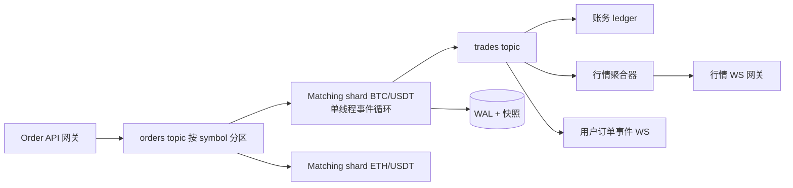
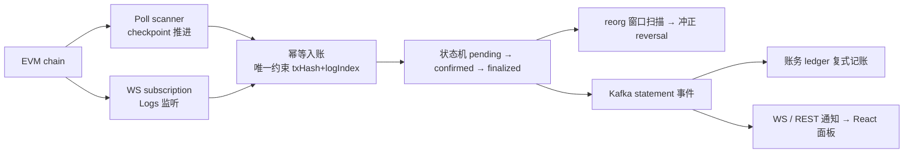
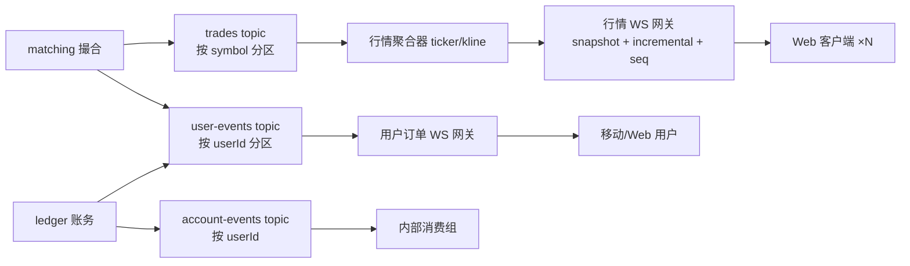
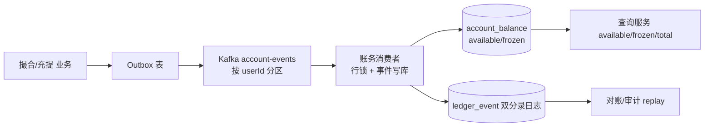
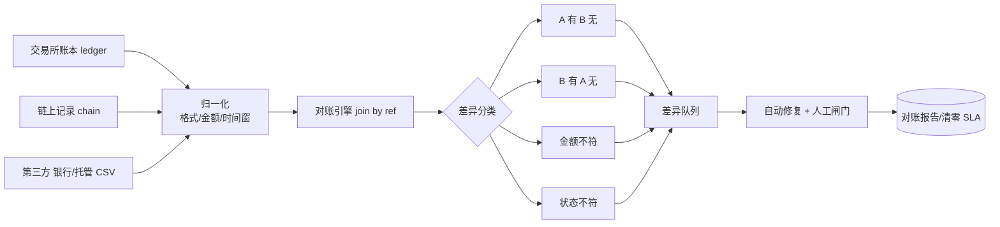
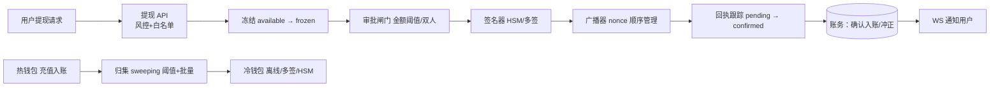
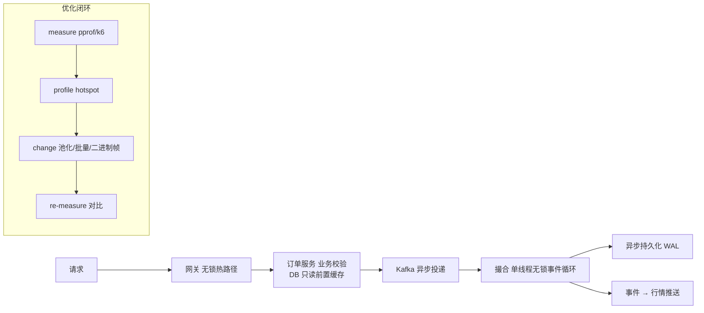
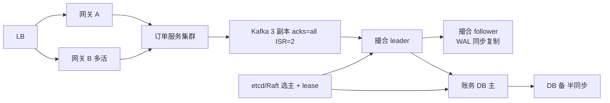

# 系统设计 8 题（Phase 7 W18 主材料）

> 与 ../roadmap.md 冻结基线一致：8 题清单为 ①撮合引擎 ②充值确认与安全 ③订单流/Kafka 拓扑/WS 网关 ④三栏账务/事件溯源/精度 ⑤三方对账 ⑥冷热钱包/提现 ⑦低延迟优化 ⑧高可用主备。
> 用法：W18 每天 1-2 题，先盖住答案做 45 分钟限时白板，再对照本文件评分；每题最终产物 = 45 分钟白板记录 + 1 页英文答案稿 + 与旗舰项目对照的一段话。
> 每题结构：题目背景（面试官视角）→ 答题流程应用 → 参考架构要点（图）→ 关键权衡（2-3 个必须讲出）→ 与旗舰项目对照的讲法 → 1 页英文答案稿模板（要点式）。

## 0. 通用答题流程模板（八题共用）

1. 需求澄清（2-3 分钟）：用户与请求类型、规模（用户数/symbol 数/并发连接）、功能范围外声明。
2. NFR（3-4 分钟）：吞吐（orders/s、msg/s、连接数）、延迟（p50/p99）、一致性（账户强一致、行情最终一致）、可用性（RTO/RPO）。
3. 架构图（8-10 分钟）：先画组件与数据流，再补消息中间件与存储；每条连线能说出「谁发谁收、什么语义」。
4. 核心模块（10-12 分钟）：每模块 1 句职责 + 1 个关键决策（数据结构/单线程/分片/幂等）。
5. 数据模型（5-6 分钟）：表/事件/键/幂等键；一笔核心对象的生命周期。
6. 故障与退化（5-6 分钟）：单点清单、级联风险、降级方案。
7. 对照项目收尾（2-3 分钟）：「我做过 X + 数字 + 生产差距」。

| 题号 | 主题 | 旗舰/项目挂点（对照讲法的主原料） |
|---|---|---|
| ① | 撮合引擎 | P2 M1：价格-时间优先、按 symbol 分片单线程、WAL+快照、fuzz 不变式 |
| ② | 充值确认与安全 | P1 全链路：扫块双轨、幂等键（txHash, logIndex）、pending/confirmed/finalized、reorg 冲正 |
| ③ | 订单流/Kafka 拓扑/WS 网关 | P2 M3：快照+增量+seq 补偿；Phase 2 种子工程：Outbox/限流 |
| ④ | 三栏账户/事件溯源/精度 | P2 M2：复式记账 + Outbox 事件流 |
| ⑤ | 三方对账 | P2 M4：账户/链上/第三方对账模块 |
| ⑥ | 冷热钱包/提现 | P2 M4：提现签名/广播/回执/归集 + PoR Merkle CLI |
| ⑦ | 低延迟优化 | P2 M5：k6 压测 3 组数据 + pprof 调优对比 |
| ⑧ | 高可用主备 | P2 WAL+快照恢复路线（讲「做到哪层、生产补哪三样」） |

---

## 题① 撮合引擎设计

### 1.1 题目背景（面试官视角）

- 原型问题：「设计一个撮合引擎，支撑一个高流动性交易对，比如 10 万活跃用户的 BTC/USDT」。面试官要听的：排序语义是否讲得清（price-time priority）、是否正确识别「撮合是状态密集的串行问题」、恢复方案、扩展方式（分片）、以及延迟与吞吐量级。
- 隐藏考点：你知不知道撮合路径上不能碰数据库、不能上锁、不能做网络调用；你知不知道 WAL + 快照是为了在崩溃后恢复内存状态。

### 1.2 答题流程应用（六段式走法）

- 澄清：taker/maker 双边从哪来（REST 下单 + 撤单 + 市价）；一个 symbol 还是一批；是否需要撮合历史持久化；范围外：不清算（账务）细节、不做风控引擎。
- NFR：单 symbol 下单峰值（如 5000 orders/s）、撮合延迟 p50 百微秒级、订单状态强一致、宕机恢复 RPO 定义为「至多丢失最后一批 WAL 记录」。
- 架构：订单 API → Kafka（orders topic，按 symbol 分区）→ 撮合分片（每 symbol 一实例或一分片，单线程事件循环）→ 撮合结果（trades/allocation）→ Kafka（trades topic）→ 账务/行情/WS 消费。
- 核心模块：内存订单簿、匹配循环、WAL 写入器、快照器、状态机（new→open/filled/partial/cancelled）。
- 数据模型：订单（orderId, symbol, side, price, qty, filledQty, status, ts）、成交（tradeId, orderId, price, qty, makerId, takerId）、WAL 事件（append-only）。
- 故障：撮合分片崩溃 → 从最近快照 + WAL 回放；Kafka 积压 → 背压、限流降级；单分片热点（把高流动性 pair 单独分片）。

### 1.3 参考架构要点（图）



- 排序语义唯一指定为 price-time priority：价格优先（买价高/卖价低在前），同价按到达时间先到先成交；每价格层内用 FIFO 队列。
- 内存订单簿：价格层用有序结构（如跳表/红黑树/二叉堆），每个价格层挂 FIFO 队列；查询与撮合都在内存完成。Go 参考：container/heap 或 sorted map。
- 每 symbol 一个分片 + 单线程事件循环：同一 symbol 的订单严格串行处理，天然免锁；跨 symbol 无状态依赖，可按 symbol 哈希到不同分片。
- 持久化：每个撮合决策追加写 WAL（append-only，批量 fsync，如每 1-5 ms 或每 N 条一批，换取吞吐）；周期性（如每小时）落快照，重启 = 快照 + WAL 回放。
- 数字量级（讲出来）：单线程内存撮合每分片约 5-20 万 orders/s（含分配优化的实现）；单笔撮合延迟 <100 µs 量级；WAL 批量 fsync 后单机恢复时间分钟级（取决于快照周期）。
- 不变式（可 fuzz）：任意时刻买/卖同一价格优先队列的顺序不变；成交价不劣于订单限价；订单剩余量与撮合成交金额守恒——P2 用 fuzz 验证的就是这一组。

### 1.4 关键权衡（必须讲出 2-3 个）

- 内存驻留 vs 恢复速度：全内存订单簿速度快，但崩溃即失 → 用 WAL + 快照换恢复能力；WAL 每次 fsync 保 RPO=0 但吞吐下降 → 批量 fsync 换吞吐、RPO 变成「至多丢失一批」。
- 单线程 vs 多线程：单线程免锁、无死锁、行为可复现（对账/回放友好）；吞吐天花板靠分片（多个单线程）而不是单线程内加锁——告诉面试官你选了「分片 + 每片单线程」而非「多线程共享订单簿」。
- 撮合与账务解耦：撮合只产出成交事件（异步给账务消费）→ 撮合路径无 DB 调用可实现低延迟；代价是账务需要消费侧幂等（Outbox/幂等键），且存在短暂不一致窗口。

### 1.5 与旗舰项目对照的讲法

- 挂 P2 M1：我实现的订单簿正是 price-time priority，按 symbol 分片、每片单线程事件循环；重启恢复用 WAL + 快照回放（具体命令与实测恢复时间写在我的 README）。
- 给数字：k6 压测数据（以 README 成果清单实测为准）+ go test -cover 覆盖率 + fuzz 不变式轮数；p99 数字对照 1.3 的量级说明「我做到的量级和生产目标的差距」。
- 生产差距补话：我会加主备复制（见题⑧）、熔断降级（撮合过载时对新单限流、撤单优先）、跨机房容灾。

### 1.6 1 页英文答案稿模板（要点式）

```text
1. Requirements & scope: match limit/market orders for one pair; cancel, partial fills;
   100k active users, 5k peak orders/s; out of scope: settlements, risk engine.
2. NFR: throughput 5k orders/s (headroom to 50k); match latency p50 <1 ms incl. API;
   strong order-state consistency; RPO = last WAL batch, RTO < minutes (snapshot+replay).
3. Architecture: API gateway -> Kafka (orders, partitioned by symbol) -> matching shard
   (single-threaded event loop per symbol) -> trades topic -> ledger / market data / WS.
4. Core modules: in-memory book (price levels + FIFO per level); matching loop;
   WAL writer (batched fsync) + hourly snapshot; order state machine new/open/partial/filled/cancelled.
5. Data model: orders(orderId,symbol,side,price,qty,filledQty,status,ts);
   trades(tradeId,price,qty,makerId,takerId); WAL as append-only event log.
6. Trade-offs: (a) memory-only book + WAL+snapshot: latency vs recovery; batched fsync
   trades RPO=0 for throughput; (b) single-thread shards over shared multi-threaded book:
   no locks, deterministic replay, scale-out by sharding; (c) matching decoupled from ledger:
   low-latency path, paid in consumer-side idempotency.
7. Failures: shard crash -> restore from snapshot+WAL; Kafka backlog -> backpressure and
   order-limiting; hot symbol -> dedicated shard.
```

---

## 题② 充值确认与安全

### 2.1 题目背景（面试官视角）

- 原型问题：「用户往交易所充值 USDC（ERC-20），怎么保证不会多记、漏记、虚记？怎么防一笔链上交易被重复入账？」考点：地址派生、扫块策略、确认数阈值、reorg 冲正、幂等键设计、金额精度。
- 隐藏考点：你知道「一笔充值」的原子键是 (txHash, logIndex) 而不是 txHash（一个 tx 可有多个 Transfer 日志）；你知道 pending/confirmed/finalized 三态与冲正；你知道测试网 1 块和主网 12 块的区别不是玄学而是资金风险定价。

### 2.2 答题流程应用

- 澄清：币种（ERC-20 稳定币）、充值地址来源（按用户按币种派生）、是否需要第三方 RPC 还是自建节点、通知渠道（REST/WS 面板）。
- NFR：入账延迟（目标：稳定币 12-30 确认 ≈ 3-8 分钟可用）；入账与冲正强一致（幂等键唯一约束）；扫块吞吐（跟随链的块速）。
- 架构：链上事件源 → 扫块器（轮询 + WS 双轨）→ 幂等入账（DB 唯一约束）→ 账务（复式记账）→ Kafka → WS/通知。
- 核心模块：地址派生器、块扫描器（checkpoint 推进）、确认数判定器、reorg 窗口扫描器、幂等入账器。
- 数据模型：deposit_address(userId, coin, address, path)；deposit(txHash, logIndex, address, coin, amount, blockNumber, status)；唯一约束 (txHash, logIndex)。
- 故障：RPC 超时 → 退避重试 + 多 RPC 轮换；WS 断连 → 回落轮询补齐区间；扫描落后 → 并行扫旧块 + 跳过积压水位告警。

### 2.3 参考架构要点（图）



- 充值地址派生：按 (userId, coin) 用 HD wallet（BIP44 路径 m/44'/60'/0'/0/i）派生专属地址，充值地址不与热钱包主地址混用；查询/找零地址汇总按用户归集。
- 扫块策略：轮询「从头到尾逐步推进 checkpoint」+ WS 订阅新块双轨；WS 断供时按 checkpoint 回落轮询，两条路径以幂等键收敛。
- 确认数：状态机三态固定为 pending / confirmed / finalized；确认数阈值可配（稳定币常用 12-30 确认 ≈ 3-8 分钟 @12s/块），达到阈值才转账（可用）。
- reorg 处理：维护短重组窗口（如 64 块深度）重扫比对的机制：扫描区间 K-64..K 内被替换的 log → 先冲正（reversal，倒扣 + 状态回退）再按新链重新入账；链深度超过窗口视为 finalized。
- 金额精度：链上 raw amount 为整数最小单位（wei），按币种 decimal 换算展示，全链路不出现浮点。
- 安全强化：入账前校验 contract address 与转账目标 = 该用户地址；重复投递（Kafka at-least-once 或手动重复提交）由唯一约束兜底（防重放攻击的机制即幂等）。

### 2.4 关键权衡（必须讲出 2-3 个）

- 确认数 vs 到账延迟：确认越多越安全、越少越快；稳定币 12-30 确认是「重组概率 vs 体验」的折中点，不设死数字而是要「阈值可配 + 对不同资产不同阈值」。
- 轮询 vs WS：轮询可靠但延迟高、WS 快但断供丢流 → 双轨并行 + checkpoint 兜底，这是工程上「既要有延迟又要有可靠性」的标准答案。
- 自建节点 vs RPC 供应商：自建有主权和成本优势但要运维同步/磁盘，供应商省事但引入第三方依赖与限流；对账（题⑤）可以让两边互相背书。

### 2.5 与旗舰项目对照的讲法

- 挂 P1：我的充值监控服务正是轮询 + WS 双轨，幂等键 (txHash, logIndex)，状态机 pending/confirmed/finalized，reorg 冲正回退后再入账；Sepolia 真实验证过一笔 USDC 充值全链路（录屏见 README）。
- 给证据：Sepolia txHash、面板/WS 通知帧截图、唯一约束的重复投递测试用例、ADR-003（双轨方案取舍记录）。
- 生产差距补话：我会加多链扩展（抽象链适配层）、确认数按币种风控配置、节点健康监控与自动切换。

### 2.6 1 页英文答案稿模板（要点式）

```text
1. Requirements: credit ERC-20 deposits to user accounts; per-user deposit addresses;
   out of scope: multi-chain, fiat rails.
2. NFR: stablecoins credited after 12-30 confirmations (~3-8 min); strong consistency for
   credit/reversal; dupes impossible (unique key); scan throughput keeps up with block rate.
3. Architecture: chain -> poll scanner (checkpoint) + WS listener (dual track) ->
   idempotent creditor (unique txHash+logIndex) -> state machine pending/confirmed/finalized
   -> reorg window scanner (reversal) -> ledger (double-entry) -> Kafka -> WS/REST notification.
4. Core modules: HD derived deposit addresses (BIP44 per user+coin); scanner with reorg
   window (64 blocks); confirmation threshold service (per asset); idempotent ledger writer.
5. Data model: deposit_address(userId,coin,address,path); deposit(txHash,logIndex,address,
   coin,amount,blockNumber,status) with UNIQUE(txHash,logIndex).
6. Trade-offs: (a) confirmations vs speed: per-asset thresholds price reorg risk vs UX;
   (b) polling vs WS: dual-track, checkpoint rollback on disconnect; (c) own node vs RPC
   provider: sovereignty/cost vs ops burden.
7. Failures: RPC timeout -> backoff + provider rotation; WS drop -> fallback polling from
   checkpoint; scanner lag -> alarm + catch-up workers.
```

---

## 题③ 订单流广播 / Kafka 拓扑 / 行情 WS 网关

### 3.1 题目背景（面试官视角）

- 原型问题：「下单、成交、行情要推给海量用户，怎么组织事件流和推送？」考点：topic 划分、分区键、消费组、顺序性、WS 网关的连接管理/心跳/重连补偿、扇出压力。
- 隐藏考点：你分得清「哪些流必须按 key 有序、哪些可以乱」；你知道快照 + 增量 + seq 补偿是行情重连的标准答案；你知道推广扇出是吞吐瓶颈。

### 3.2 答题流程应用

- 澄清：事件类型（订单/成交/行情）、消费者（Web 用户/移动端/内部服务）、单用户订阅多个 symbol、是否需要回放（kline 历史走 REST）。
- NFR：推送 p99 < 50 ms（从撮合成交到用户可见）；单网关 5-10 万连接；行情更新率（如 1 ticker/s/symbol 聚合成 100ms 快照）。
- 架构：撮合 → trades topic → 行情聚合器（ticker/kline 每秒/分钟聚合）→ 行情 WS 网关；订单服务 → 用户私有事件 topic → 用户 WS 网关。
- 核心模块：主题划分、分区键选择、消费组设计、WS 网关（连接注册表/心跳/订阅表/扇出器/seq 补偿）。
- 数据模型：事件信封（eventType, symbol, seq, ts, payload）；订阅关系（connId → set[symbol]）；快照 + 增量 seq 水位。
- 故障：Kafka broker 掉 → ISR 收缩 + 重平衡；WS 连接慢消费 → 断开或退化为拉取快照；聚合器挂 → 行情降级为直推 trades。

### 3.3 参考架构要点（图）



- Topic 划分：orders（入站）、trades（成交，按 symbol 分区保证同 symbol 有序）、account-events（按 userId 分区）、market-data（ticker/kline 聚合流）。
- 分区键语义：trades 按 symbol → 同 symbol 成交顺序可复现；account-events 按 userId → 单用户余额变动严格有序；禁止用全局随机键承载「需要有序」的流。
- 消费组：每个下游服务一个消费组独立平移（账务组、行情聚合组、通知组），组内并发度 = 分区数。
- 发布端一致性：订单服务事务内写账务/订单表 + Outbox 表，发件人进程把 Outbox 行投递到 Kafka 后删除 → at-least-once + 消费端幂等，替代分布式事务。
- WS 网关：每连接 goroutine 读 + 临界区扇出写；心跳 ping/pong（30s）检测死连；订阅表 (conn, symbol)；慢消费者降级：先踢再允许重连拉快照。
- 重连补偿协议（P2 M3 实测过）：连接后先拉快照 + last_seq，再收增量，seq 不连续则重新拉快照；snapshot + incremental + seq 三件套缺一不可。
- 数字量级：单网关 5-10 万连接量级（内存与扇出线性相关）；无积压时 Kafka 端到端 10-50 ms；行情推送 p99 < 50 ms（含聚合）；二进制帧（Protobuf）比同量 JSON 省带宽 50%+。

### 3.4 关键权衡（必须讲出 2-3 个）

- 顺序 vs 扩展性：按 symbol/userId 分区换「多消费者并行 + 有序」，代价是单个热 key 的分区仍是串行 → 热点 symbol 独立分区；讲「顺序是业务属性（谁的有序），分区是手段」。
- 推（push）vs 拉（pull 回放）：全量推带宽爆炸；只推增量 + 断线快照恢复是「带宽 vs 重连复杂度」的平衡点；连接解散后一切从快照重建。
- 单网关 vs 多网关：连接哈希分散到多网关后，同 symbol 广播需要跨网关复制（pub/sub 层，如 Redis/Kafka 桥）或中心扇出 → 常用「中心聚合 + 边缘网关扇出」两级结构。

### 3.5 与旗舰项目对照的讲法

- 挂 P2 M3：行情 WS 我实现了快照 + 增量 + seq 补偿，断线重连后按 last_seq 追增量；kline/ticker 在聚合器里算而不是在网关里算。
- 给数字：k6 压测下 WS 连接数/推送延迟（README 成果清单实测）+ 重连补偿的测试用例（故意断流 → 快照恢复验证录屏）。
- 生产差距补话：我会加多级网关与跨区域广播、订阅配额与连接数上限、行情降级开关（聚合器挂了直推 trades）。

### 3.6 1 页英文答案稿模板（要点式）

```text
1. Requirements: broadcast trades/market data and user-order events; clients subscribe
   per symbol; kline history via REST; out of scope: chat, notifications.
2. NFR: push p99 <50 ms; 50-100k concurrent conns per gateway; per-symbol order preserved;
   reconnect resume within 3 s (snapshot+seq).
3. Architecture: trades topic (partitioned by symbol) -> aggregator (ticker/kline) ->
   market-data WS gateway; user-events topic (by userId) -> user WS gateway.
4. Core modules: topic/partition design; consumer groups per service; WS gateway:
   conn registry, heartbeat ping/pong 30s, subscription map, fan-out writer; resume via
   snapshot + last_seq + incremental.
5. Data model: event envelope (eventType,symbol,seq,ts,payload); subscription (conn,symbol set);
   Outbox table for transactional publish of account events.
6. Trade-offs: (a) partition by key preserves order, limits parallelism per key;
   (b) push incrementals + pull snapshot on reconnect vs full push: bandwidth vs resume
   complexity; (c) central aggregator + edge gateways: one broadcast source, conn fan-out.
7. Failures: broker down -> ISR shrink/rebalance; slow consumer -> disconnect and
   snapshot resume; aggregator down -> degrade to raw trades.
```

---

## 题④ 账户三栏模型 / 事件溯源 / 精度

### 4.1 题目背景（面试官视角）

- 原型问题：「用户余额怎么存？下单冻结、成交转可用、撤单解冻、充值提现，怎么保证不超扣、不丢钱？金额用什么类型？」考点：三栏模型、复式记账、事件溯源、幂等、精度。
- 隐藏考点：你知不知道 available/frozen/total 的不变式；复式记账是审计与对账的地基；金额必须整数最小单位；并发扣款靠行锁或乐观锁而不是「先读后写」。

### 4.2 答题流程应用

- 澄清：币种数量（几十个）、操作类型（充值/提现/下单冻结/成交/解冻/手续费）、是否需要审计回放、多账户（子账户/团队账户）。
- NFR：账户变动强一致（行级串行化）、吞吐（如 1-5 万笔/日规模项目按 10 倍余量）、单笔扣款延迟目标 <50 ms（含 DB）、审计可追溯。
- 架构：业务事件（Outbox）→ 账务消费者 → 双分录写 ledger_event + 余额表（同事务）→ 投影余额表供查询；对账与审计读事件日志。
- 核心模块：三栏余额表、冻结/解冻/转账（资金锁定与释放）、精度归一器、幂等事件写入器、试算平衡任务。
- 数据模型：account_balance(userId, coin, available, frozen)；ledger_event(eventId, userId, coin, amount, type, ref, bizId)；唯一约束 bizId。
- 故障：消费重放 → 幂等跳过；DB 死锁 → 重试；对账不平 → 差异队列 + 人工闸门。

### 4.3 参考架构要点（图）



- 三栏模型：account_balance 每行只有 available 与 frozen 两列，total = available + frozen 是账务系统的不变式；冻结 = 下单时从 available 扣入 frozen（UI 仍显示可用性为 available）。
- 资金生命周期：下单 → available -X / frozen +X；成交 → 按成交额 frozen -Y（余额部分）并记双分录；撤单 → frozen -Z / available +Z；每一笔都是同事务内的余额变动 + 事件追加。
- 复式记账：每笔业务事件至少两条分录（来源方），分录总和恒为 0（借贷平衡），试算平衡任务每日校验 ∑=0 —— 这是对账与审计的根。
- 事件溯源与现成数据库双轨：ledger_event 为真相源可回放重建余额（崩溃/人为误改可恢复），account_balance 为投影表供高速查询；二者同事务写入保证一致。
- 精度：金额一律整数最小单位（如 1e-8 的 coin 字段存 int64/定长 decimal），禁止 float64 记账（0.1+0.2 与舍入分摊问题）；API 层按 decimal 展示。
- 并发控制：单账户行级触达（SELECT ... FOR UPDATE 或乐观锁 version）串行化同账户并发变动；跨账户转账用固定顺序加锁（userA < userB）防死锁。
- 幂等：每个业务事件带全局唯一事件 id（bizId），账务表对该 id 建唯一约束，Kafka at-least-once 重投时插入失败即幂等跳过（消费端 idempotency）。

### 4.4 关键权衡（必须讲出 2-3 个）

- 事件溯源 vs 现成数据库直写：事件溯源给审计/回放/对账带来全额透明度，代价是查询需要投影与专职消费者（复杂度）；双轨并用是「既要回放又要查询」的工程折中。
- 冻结粒度：下单即全额冻结（简单、资金安全）vs 分批冻结（体验好、复杂度高）——小规模项目选全额冻结，讲清楚「冻结粒度 = 可用性与状态机复杂度之间的定价」。
- 行锁 vs 乐观锁：行锁确定性好（交易所爱用）但高并发同账户排队；乐观锁适合低冲突；对「一个账户被高频交易」的场景讲行锁串行化是安全的，吞吐靠业务分账户而不是抢锁。

### 4.5 与旗舰项目对照的讲法

- 挂 P2 M2：我的账务是复式记账 + Outbox 事件流，撮合出的成交事件经 Outbox → Kafka → 账务消费者逐笔双分录入账；余额表就是 available/frozen 两列，total 恒等校验进了单测。
- 给证据：覆盖率的账务包数字、试算平衡测试、并发扣款用例（重复提交被唯一约束拦截）、精度测试（0.01 USDT 一类边界值）。
- 生产差距补话：我会加多名币币账户隔离（spot/futures）、日终试算平衡调度、报表与监管导出。

### 4.6 1 页英文答案稿模板（要点式）

```text
1. Requirements: track balances per user per coin; freeze on order, transfer on fill,
   unfreeze on cancel; deposit/withdraw; audit trail; out of scope: margin, fees report.
2. NFR: strong per-account consistency (row-level serialization); credit/freeze latency
   <50 ms; full auditability; invariant total = available + frozen always holds.
3. Architecture: business events (Outbox) -> Kafka (by userId) -> ledger consumer (row lock +
   event append in one tx) -> balance projection + ledger_event log; reads from projection,
   audit from log (event sourcing dual-track).
4. Core modules: three-pillar balance store; freeze/unfreeze/transfer ops; precision
   normalizer (int64 min unit); idempotent writer (UNIQUE bizId); daily trial-balance check.
5. Data model: account_balance(userId,coin,available,frozen);
   ledger_event(eventId,userId,coin,amount,type,ref,bizId) UNIQUE(bizId); double-entry:
   every event >= 2 entries, sum = 0.
6. Trade-offs: (a) event sourcing vs plain DB: auditability/replay vs projection complexity,
   run both in one tx; (b) freeze-all-on-order vs staged freezing: simplicity vs UX;
   (c) row lock vs optimistic: deterministic vs throughput, same-account serialization is safe.
7. Failures: consumer replay -> unique key skips; deadlock -> retry; imbalance ->
   diff queue + manual review gate.
```

---

## 题⑤ 三方对账

### 5.1 题目背景（面试官视角）

- 原型问题：「交易所账本、链上记录、银行/托管，怎么证明三方一致？对不上怎么办？」考点：对账单元、时间窗对齐、差异分类、修复流程、自动化与人工闸门。
- 隐藏考点：你知道对账不是「数对得上就可以了」，而是「两侧独立生成的记录作 join，找差异并限时清零」；异常修复要有痕迹可审计。

### 5.2 答题流程应用

- 澄清：对账三方（交易所账本 / 链上记录 / 第三方银行或托管）、周期（日结 + 流式）、对账粒度（每笔 vs 每日汇总）、谁来触发修复。
- NFR：日终对账完成率 100%（全量）；差异发现到清零 SLA 24h；对账任务本身幂等可重跑。
- 架构：三路数据源 → 归一化（格式/金额/时间窗）→ 按对账单元 join → 差异分类 → 差异队列 → 自动修复 + 人工闸门 → 报告。
- 核心模块：数据源适配器、归一化器、对账引擎、差异分类器、修复工单。
- 数据模型：对账记录（ref, side, amount, status, window）；差异（type, amountDelta, status, owner）；修复工单（ref, 动作, 执行人/系统, 证据）。
- 故障：源导出缺失 → 延迟窗口重试再告警；时间窗边界（跨 UTC 日）→ 固定截止偏移；修复冲突 → 单执行者锁。

### 5.3 参考架构要点（图）



- 对账单元：每笔业务记录的对账键（充值用 (txHash, logIndex)、提现用 (withdrawId, txHash)、法币用批次号/流水号），两侧记录按该键 join；无键可 join 的是最危险的差异。
- 时间窗对齐：链上按「确认时间 + 固定偏移」、账本按「入账时间」、第三方按「结算日」，统一到 UTC 日 + 截止偏移（如 T+1 02:00）避免「差一笔在途」误报。
- 差异四分类（必讲）：A 有 B 无 / B 有 A 无 / 金额不符（含手续费口径）/ 状态不符（如链上 confirmed 但账本 pending）→ 每类给一个典型原因与处置。
- 修复流程：自动修复只处理可证明安全的（如手续费口径归一、状态补推）；涉及钱的差异走人工工单 + 双人复核；所有修复动作留痕（谁/何时/证据/对应冲正记录）。
- 数字与指标：日终对账完成率 100%（全量非抽样）、差异清零 SLA 24h、报告含差异数/金额/分类分布。

### 5.4 关键权衡（必须讲出 2-3 个）

- 全量 vs 抽样：交易所必须全量（抽样的结论对不了资金账），成本靠增量/分片对账控制——对账不做统计抽样，这是风控底线。
- 自动修复 vs 人工闸门：自动化应付可证明的差异、快；资金相关的认知风险全部进人工双人复核——「自动测绘、人工拆弹」。
- 时间窗对齐口径 vs 实时性：严格对齐（T+1 截止）报表稳定但发现晚；流式差异告警发现快但噪声多 → 日结为账本纪律，流式为快速发现。

### 5.5 与旗舰项目对照的讲法

- 挂 P2 M4：我的对账模块把交易所账本与链上记录按 (txHash, logIndex) 对账，另一侧用托管 CSV 模拟第三方；差异分类与工单流程都有（具体表结构与页面在我的 README）。
- 给证据：对账任务输出样例（两侧记录 + 差异行）、差异处置测试用例、docs/review.md 里「重复入账被对账抓到」的坑故事（这是面试加分点）。
- 生产差距补话：我会加多币种并行调度、流式差异告警、与监管报表的自动导出。

### 5.6 1 页英文答案稿模板（要点式）

```text
1. Requirements: reconcile exchange ledger vs chain records vs third-party (bank/custody);
   daily full-run + streaming anomaly alerts; out of scope: fraud investigation system.
2. NFR: 100% record coverage per close; discrepancy-to-zero SLA 24 h; rerunnable idempotent.
3. Architecture: adapters (ledger/chain/CSV) -> normalization (format, amount, UTC day +
   late-cutoff) -> join by reconciliation ref -> 4 diff classes -> diff queue ->
   auto-fix + manual dual-review gate -> report.
4. Core modules: ref mapper (deposit: txHash+logIndex; withdraw: withdrawId+txHash);
   window aligner; diff classifier; work-order store with full audit trail.
5. Data model: recon_record(ref,side,amount,status,window); diff(type,delta,status,owner);
   work_order(ref,action,actor,evidence) - every fix leaves a trace.
6. Trade-offs: (a) full vs sampled recon: exchanges must be full; (b) auto-fix only for
   provable diffs (fee basis, status re-push), money diffs -> manual dual review;
   (c) strict T+1 close vs streaming alerts: stable statements vs early detection.
7. Failures: missing source dump -> delayed window retry + alarm; window-boundary noise ->
   fixed cutoff offset; fix conflicts -> single executor lock.
```

---

## 题⑥ 冷热钱包 / 提现

### 6.1 题目背景（面试官视角）

- 原型问题：「用户提现 Ethereum 上的 USDC，怎么设计提现链路与钱包体系？私钥怎么办？」考点：冷热分层、归集、提现状态机、重放防护、密钥管理、风控闸门。
- 隐藏考点：你知道「热钱包余额上界」是风控关键数字；提现广播后回执跟踪与冲正是资金安全闭环；nonce 顺序与重放防护是链上工程的真正难点。

### 6.2 答题流程应用

- 澄清：支持的链/币种、提现频率与单笔规模分布、是否支持地址白名单、审计与多签要求。
- NFR：热钱包余额上界（如总资产 1-3%）、提现广播延迟目标（热钱包路径 < 2 分钟）、回执跟踪全覆盖（广播 ≠ 成功）、提现幂等（用户侧重复请求不重复扣款）。
- 架构：提现 API → 风控 → 冻结 → 审批队列 → 签名器（HSM/多签）→ 广播器（nonce 管理）→ 回执跟踪 → 账务冲正/确认 → WS 通知。
- 核心模块：提现状态机、签名器、nonce 管理器、回执跟踪器、归集调度器、密钥管理。
- 数据模型：withdraw(withdrawId, userId, coin, amount, toAddress, status, txHash, nonce)；归集任务（fromHot, toCold, amount, txHash）；审批记录。
- 故障：广播超时 → 重试（同 nonce 同 tx）；nonce 空洞 → 补齐策略防卡单；签名器不可用 → 提现队列暂停 + 告警。

### 6.3 参考架构要点（图）



- 冷热分层：热钱包联机签名、承担日常充提、公开地址；余额上界 = 风控数字（如总资产 1-3%），超出即触发归集；冷钱包离线/多签/HSM 持有绝对大头。
- 归集策略：充值入热钱包后按「阈值 + 时间」批量归集到冷钱包（如热钱包超 5 ETH 或每 4 小时），可减少 gas 与热暴露面；防 dust 与最小归集额。
- 提现状态机：requested → frozen → signed → broadcast → pending → confirmed / failed(reversal)；pending 超时未确认按网络重试与费用调整（EIP-1559 动态 gas）。
- 广播与 nonce：同一地址的交易按 nonce 严格递增（同送出队列单飞），nonce 空洞会卡住全部后续交易；失败重试用同 (addr, nonce) 替换重抛。
- 重放防护：每个提现请求生成全局唯一 withdrawId，签名消息里包含它（链下防重放）+ 扣款幂等（bizId 唯一约束）；链上同一 tx 重复广播天然幂等（同 txHash）。
- 密钥管理：助记词/私钥不落代码库不落日志；冷钱包私钥分片或托管多签；热钱包私钥入 HSM 或加密存储 + 权限审计——把 Phase 4 威胁模型里「提现签名」资产的缓解措施讲进来。

### 6.4 关键权衡（必须讲出 2-3 个）

- 热钱包余额上界 vs 提现体验：余额越大越少触发归集（快）但热暴露风险越大；1-3% 上界是行业常见风控定价，归集阈值可配。
- 签名集中 vs 分布式：单签名器实现简单、运维清晰，但成单点 → 双签名器主备 + 冷转热子通道；多签提升安全但复杂度与门槛数线性增长。
- 自动审批 vs 人工闸门：小额自动、大额/新地址人工双人复核——风控与体验的边界按金额与地址信誉动态调整（白名单地址提速）。

### 6.5 与旗舰项目对照的讲法

- 挂 P2 M4：提现链路（签名 → 广播 → 回执 → 冲正回滚）与冷热分层归集我都做了，还带一个简化版 PoR（Merkle 证明 CLI）。
- 给证据：Sepolia 真实提现录屏（回执 pending→confirmed 状态变化）、提现幂等测试（重复请求不重复扣款）、docs/security.md 密钥管理书面记录、威胁模型（10 条验收③）。
- 生产差距补话：我会接 HSM 与多签、提现频率风控引擎、对账联动（题⑤把提现纳入三方对账）。

### 6.6 1 页英文答案稿模板（要点式）

```text
1. Requirements: user withdraws USDC (ERC-20); hot/cold wallet tiers; address whitelist;
   out of scope: cross-chain bridges, custodial services for third parties.
2. NFR: hot wallet balance cap 1-3% of total; broadcast within <2 min on hot path;
   every broadcast tracked to confirmed/failed; withdraw idempotent across retries.
3. Architecture: withdraw API (risk + whitelist) -> freeze -> approval gate (amount
   threshold, dual review) -> signer (HSM/multisig) -> broadcaster (per-address nonce
   serialized) -> receipt tracker (pending/confirmed) -> ledger settle/reversal -> WS notify.
4. Core modules: withdraw state machine; nonce manager (no gaps); sweeper (threshold+
   batch to cold); key management (shards/multisig/HSM, never in code or logs).
5. Data model: withdraw(withdrawId,userId,coin,amount,to,status,txHash,nonce) UNIQUE
   (withdrawId); sweep jobs; signed message includes withdrawId (off-chain replay guard).
6. Trade-offs: (a) hot cap vs withdrawal UX: 1-3% cap, configurable sweep threshold;
   (b) single vs dual signer: single point vs ops complexity; (c) auto small / manual
   large withdrawals: risk boundary priced by amount + address reputation.
7. Failures: broadcast timeout -> retry with same (addr,nonce); nonce gap -> fill or
   reorder queue; signer down -> queue withdrawals + alarm.
```

---

## 题⑦ 低延迟优化

### 7.1 题目背景（面试官视角）

- 原型问题：「下单到成交通知的延迟怎么压？给你 100 万 QPS 的行情推送要求，怎么设计？」考点：延迟预算、测量先行、优化手段分层（内存/锁/系统调用/协议/拓扑）、LMAX 与单线程、GC 与池化。
- 隐藏考点：你敢不敢说「先测量再优化」；你知不知道热路径不能有 DB/网络/锁；优化与可维护性之间要有止损线。

### 7.2 答题流程应用

- 澄清：优化目标路径（下单 → 撮合 → 成交通知）、要优化的是 p50 还是 p99、硬件与部署环境（同机房？云？）。
- NFR：给出延迟预算：API→撮合 p99 < 5 ms；撮合单笔 < 100 µs；行情推送 p99 < 50 ms；预算表逐段分解（测量后才知道瓶颈在哪段）。
- 架构：测量（pprof/压测）→ 定位（热路径/hotspot）→ 分层优化 → 复测对比，闭环迭代；热路径与外围路径分离。
- 核心模块：无锁/单线程撮合、对象池、批量 IO、二进制协议、异步持久化。
- 数据模型：不涉及新表；优化对象是运行时的分配/锁/系统调用。
- 故障：优化引入的回归由压测对照把关；内存占上界由 GOMEMLIMIT 兜底。

### 7.3 参考架构要点（图）



- 延迟预算（必讲数字）：账户校验 + 下单 API p99 < 5 ms；撮合 < 100 µs/单；Kafka 端到端 10-50 ms；行情推送 p99 < 50 ms；每段预算给「谁负责压」。
- 分层优化清单（从收益最大到最小，按实测取舍）：
  1. 热路径免分配：对象池（sync.Pool）、预分配字节缓冲、避免 fmt 拼接（用 bytes.Buffer/Builder）、避免大 slice 复制；
  2. 热路径无锁：撮合单线程事件循环；读多写少用原子/共享死读不拷贝；
  3. 减少系统调用：批量写 WAL/日志、内核旁路留给未来（按需讲 io_uring/netpoll）；
  4. 协议层：二进制帧（Protobuf）替代 JSON、连接复用、批量订阅；
  5. 拓扑层：撮合路径不碰 DB（业务校验读走缓存）、持久化异步化、冷路径（报表/风控）全部挪出热链路。
- LMAX 参考（必引）：单线程 + 无锁环形缓冲加事件驱动，把「并发共享状态」改成「单点串行处理」；参考量级对比：商品硬件单线程内存撮合约 5-20 万 orders/s、延迟 <100 µs（参考 LMAX 架构一文）。
- GC 调优：p99 毛刺常来自 GC 与分配 → 池化 + GOGC 调优 + GOMEMLIMIT（Go 1.19+）限内存防抖动；压测前后 pprof 火焰图对比留档。
- 压测闭环：k6 跑 3 组数据（如 10/50/100 并发）、记录 QPS/P50/P99/错误率，优化前后各一组做对照——这是「优化是真的」的外部证据。

### 7.4 关键权衡（必须讲出 2-3 个）

- 优化 vs 可维护性：设止损线（达到预算即停手），面向 p99 而非极限压榨；先测量后优化，避免「优化了不热的路」。
- 内存驻留 vs 恢复速度：全内存订单簿免 IO 但崩溃即失 → WAL + 快照换恢复；批量 fsync 用 RPO 换每秒吞吐。
- 吞吐 vs 一致性：异步持久化/传播提吞吐，代价是短暂的不一致窗口 → 用幂等消费与对账兜底（呼应题③④⑤）。

### 7.5 与旗舰项目对照的讲法

- 挂 P2 M5：我做了 k6 3 组压测，先跑基线再用 pprof 定位热路径，做了 2-3 处调优（对象池/批量写/避免热路径锁），前后数据对比在我的 README 压测报告里。
- 给证据：压测报告具体数字（并发数/QPS/P50/P99/错误率）、pprof 火焰图前后对比、补充的分摊日志（10 条验收⑩）。
- 生产差距补话：我会加低延迟网络栈调研（按需）、热路径与冷路径物理分离（独立实例）、跨机房部署基准测试。

### 7.6 1 页英文答案稿模板（要点式）

```text
1. Requirements: cut latency from order submit to fill notification; optimize p99, not
   just p50; out of scope: infra procurement, hardware tuning.
2. NFR budget: API->match p99 <5 ms; match <100 µs; market-data push p99 <50 ms;
   each segment has an owner.
3. Architecture: gateway (lock-free read path) -> order service (no DB in hot path,
   cached checks) -> Kafka (async) -> matching (single-threaded event loop, lock-free)
   -> async WAL + event push.
4. Core: allocation-free hot path (sync.Pool, preallocated buffers), lock-free matching,
   batched IO, binary frames (Protobuf), cold paths moved out of the hot loop.
5. Optimization loop: measure (pprof+k6) -> profile -> change -> re-measure, archived.
6. Trade-offs: (a) optimize until budget, not to zero: maintainability stop-line;
   (b) in-memory book vs recovery: WAL+snapshot, batched fsync trades RPO for throughput;
   (c) async persistence: throughput up, consistency window -> idempotency + recon.
7. Failures: GC spikes -> pooling + GOGC/GOMEMLIMIT; regression -> guarded by pre/post
   load-test comparison; memory cap via GOMEMLIMIT.
```

---

## 题⑧ 高可用主备

### 8.1 题目背景（面试官视角）

- 原型问题：「撮合宕机 5 分钟意味着什么？账务主库挂了怎么办？怎么设计主备与故障切换？」考点：无状态层多活、有状态层复制、选主与脑裂、RTO/RPO、降级、演练。
- 隐藏考点：你知道「高可用」必须先定义 RTO/RPO 再谈架构；你知道自动切换必须带脑裂防护（fencing）；你会把故障场景列成清单而不是背方案。

### 8.2 答题流程应用

- 澄清：故障面（撮合/账务/行情/Kafka）、可接受的停机（RTO）与丢失（RPO）、单机房还是多机房。
- NFR：RTO < 30 s（有状态层故障切换）、RPO 定义（如「至多丢失最后一批 WAL」）、无状态层多活（LB 摘除即恢复）、每季度一次故障演练。
- 架构：无状态层（网关/订单服务/WS 网关）多副本 + LB；有状态层（撮合 leader-follower 复制 + 选主；账务 DB 主从半同步自动 failover；Kafka 集群 3 副本）。
- 核心模块：选主（etcd/Raft 或 DB lease）、WAL 同步复制、fencing token、故障探测与自动切换、降级开关。
- 数据模型：复制依赖 WAL/主从 binlog 语义，讲清「数据在哪些载体、谁复制谁」。
- 故障清单：单实例 Kill、Kafka broker 掉 1/2、主从延迟、网络分区（脑裂）——每项给判定与处置。

### 8.3 参考架构要点（图）



- 分层 HA 原则：无状态层不解决「状态去哪了」，只负责「流量随时可去任何副本」；状态都在三个载体：撮合内存（WAL 兜底）、账务 DB、Kafka。
- 撮合主备：leader 处理全部该 symbol 订单，WAL 同步复制给 follower；leader 失联 → 选主（etcd/Raft 或 DB lease）提升 follower，回放 WAL 到最新后接管；fencing token 防止旧 leader 复活后继续写（脑裂防护，必讲）。
- 账务 DB 主备：半同步复制（备确认才提交）保 RPO≈0，主故障自动 failover + 应用层重连；写全部走主，读走备/缓存副本。
- Kafka 高可用：3 副本、min.insync.replicas=2、生产者 acks=all，broker 掉 1 不丢消息、ISR 收缩触发告警；消费组重平衡自动恢复消费。
- 降级策略（必讲）：行情只读（撮合正常但新单限流）、下单熔断（返回明确错误而非积压）、提现暂停（签名器不可用时的安全姿态）、对账作为最后兜底（事后发现与修复）。
- 演练与度量：定期 Kill -9 一台、断网分区演练，记录切换时长是否 ≤RTO；每次演练输出「发现 - 修复 - 验证」。

### 8.4 关键权衡（必须讲出 2-3 个）

- Active-Standby vs Active-Active：主备简单但备机闲置、切换有窗口；双活吞吐高但要求冲突解决与更复杂的一致性协议——交易所账务/撮合常用主备优先，行情网关双活。
- 同步 vs 异步复制：同步 RPO≈0 但写延迟随备机增加；异步快但有丢失窗口 → 账务用半同步、撮合用 WAL 同步+批量，把 RPO 定义显式讲出来。
- 自动切换 vs 人工切换：自动快但引入脑裂/误切风险（必须有 lease + fencing）；人工稳但放大 RTO——「自动探测 + 人工确认」混合是常见折中，关键路径（撮合）自动。

### 8.5 与旗舰项目对照的讲法

- 挂 P2：我的撮合是单进程 + WAL + 快照回放，我做到了「崩溃后恢复到最近状态」这半边；备机复制、选主、fencing 是我在生产差距里明确列出的三项。
- 给证据：恢复测试（kill -9 后重启回放成功的用例/录屏）、ADR 记录（为什么选 WAL+快照路线）、文档里写明的 RPO 定义。
- 生产差距补话：按 8.3 列三件：leader-follower WAL 同步 + etcd 选主 + fencing；DB 半同步 failover；每季度演练记录。把「我知道差在哪、怎么补」讲出来本身就是高分。

### 8.6 1 页英文答案稿模板（要点式）

```text
1. Requirements: HA for matching, ledger, Kafka; define RTO/RPO first; out of scope:
   cross-region DR for this round.
2. NFR: RTO <30 s for stateful failover; RPO = last WAL batch (ledger: ~0 via semi-sync);
   stateless tiers fully multi-active; quarterly drills.
3. Architecture: LB + stateless gateways/order service; matching leader-follower with WAL
   sync, leader election via etcd/Raft + lease + fencing; ledger DB primary/standby
   semi-sync failover; Kafka 3 replicas, ISR=2, acks=all.
4. Core modules: election with fencing token (split-brain guard); WAL follower replication
   + replay; probe/alarm/switch automation; degradation switches (read-only market data,
   order throttling, withdraw pause).
5. Data: state lives in three carriers - matching memory (WAL), ledger DB, Kafka;
   each has defined replication and failover.
6. Trade-offs: (a) standby vs active-active: simplicity/switch window vs throughput and
   conflict resolution; (b) sync vs async replication: RPO≈0 vs write latency,
   semi-sync as middle ground; (c) auto vs manual failover: speed vs split-brain risk ->
   lease + fencing, auto on the matching path.
7. Failure list: instance kill, broker 1/2 down, replication lag, network partition -
   each with detection, action, and drill evidence.
```

---

## 收尾：8 题复用清单

- 每题必带的「三件套」：1 个排序/一致性语义（price-time priority、按 key 分区有序、双分录平衡）、2 个带代价的取舍、≥3 个具体数字。
- 每题结尾固定句式：「我在 P2/P1 里做了 X（模块 + ADR），实测 Y（数字），生产环境我会补 Z」。
- 八题之间存在共用论据，讲熟一题即复用一题：Outbox/幂等（②③④）、WAL+快照（①⑦⑧）、按 symbol 分片（①③）、三方对账兜底（②⑤⑥）、GC 与池化（⑦⑧）。