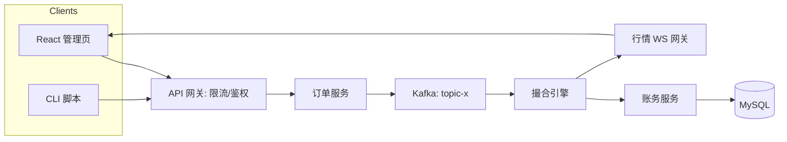

# projects/SPEC-template.md — 项目规格书模板（v1.0）

> 用途：后续 P0-P4 五个项目 SPEC 统一使用本模板，复制后填写，禁止改动章节骨架。
> 引用规则：行内引用 `../roadmap.md`（冻结基线）、`../standards/project-acceptance-10.md`（验收）、`../standards/code-quality.md`（代码规范）、`../CLAUDE.md`（术语/资源池）。
> 填写要求：里程碑退出条件与验收勾选必须**布尔可判**（见 CLAUDE.md 3.3）；「弹性」标记的条目在低档位可砍。

---

# SPEC-{Px}：{项目名}

| 元信息 | 值 |
|---|---|
| 项目编号 | Px |
| 所属阶段 | Phase N（第 x-x 周） |
| 状态 | Draft → **Review** → Frozen（终审后冻结） |
| 版本 / 日期 | v1.0 / YYYY-MM-DD |
| 作者 | 对应阶段作者 |

## 1. 业务范围

一句话定位：{用一句话说明这个项目是什么、给谁用、解决什么问题}。

核心业务流程（编号化，供第 5 节架构图对照）：
1. {流程 1：入口 → 处理 → 出口}
2. {流程 2}
3. {流程 3}

## 2. 目标与边界

**Goals（本项目要做到的）**：
- {G1：可验收的成果，指向验收勾选表的某几条}
- {G2}
- {G3}

**Non-Goals（明确不做，防止范围蔓延）**：
- {NG1：如「不做撮合延迟低于 1ms 的极速链路」「不做多币种」「不做合约/杠杆」}
- {NG2}
- {NG3 至少写 3 条}

## 3. NFR（非功能需求）

| 类别 | 指标 | 目标值 | 测量方式 |
|---|---|---|---|
| 性能 | QPS / 延迟 | {下单接口 P50 ≤ 5ms、P99 ≤ 30ms @ 500 并发} | k6 脚本（scaffolds/k6），结果入压测报告 |
| 性能 | {压测组数} | {3 组数据 + pprof 调优前后对比} | 报告含调优对比表 |
| 一致性 | 强一致边界 | {账务/余额变更强一致（单库事务）；行情最终一致} | 测试 + 文档说明边界 |
| 一致性 | 幂等范围 | {充值按 (txHash, logIndex) 幂等；下单按 clientOrderId 幂等} | 重复投递测试用例 |
| 安全 | 资金安全 | {密钥不进 git/日志；提现需签名；余额扣减在事务内} | 威胁模型文档 + 代码审查 |
| 可观测 | 日志/指标 | {结构化日志 + request-id；核心指标进 Prometheus} | CI 检查 + 文档 |

## 4. 技术栈（版本锁定）

| 组件 | 选型 | 版本 | 用途 | 备注 |
|---|---|---|---|---|
| 语言 | Go | 1.{xx}（与 go.mod 一致） | 主线 | CI 中固定同版本 |
| Web 框架 | Gin | {x.y.z} | HTTP API | 与 scaffolds/go 骨架一致 |
| 数据库 | MySQL | 8.{x} | 业务主存储 | docker-compose 同版本 |
| 缓存/锁 | Redis | 7.{x} | 缓存/分布式锁 | |
| 消息队列 | Kafka | 3.{x} | 事件流 | 主题命名见数据模型 |
| 链 | {Sepolia / Solana devnet} | — | 测试网 | 见第 6 节 |
| 链库 | go-ethereum / {anchor} | {版本} | RPC 扫块 / 程序 | |
| 前端 | React + {lightweight-charts} | {版本} | 管理页/深度图 | 若适用 |
| 合约 | Solidity + Foundry | {0.8.x / foundry vX} | P3 | foundry.toml 锁版本 |
| 部署 | Docker Compose / GitHub Actions | — | 环境与 CI | 模板见 scaffolds/ |

约束：中间件版本与 `scaffolds/docker-compose` 基线一致；新增组件必填「备注」。

## 5. 架构图（Mermaid 占位）

**组件职责表**：{每个组件一句话：职责 + 数据进/出}。

**关键数据流**（与第 1 节编号对应）：
- {D1：第 1 节流程 1 的组件路径与消息格式要点}
- {D2}

## 6. 数据模型要点

- 核心表/实体：{表名 + 职责 + 关键字段（含唯一约束/索引）}；字段命名遵守 code-quality 1.1。
  - {表 1：orders — id, client_order_id(UNIQUE), symbol, side, price, quantity, status, timestamps}
  - {表 2}
- 账本结构（若适用）：三栏 frozen/available/total 存于 {account 表 + 流水表}；复式记账分录格式 {from/to/amount 约束}。
- 幂等键设计：{(txHash, logIndex) / clientOrderId} 落在哪张表的唯一约束。
- 链上（若适用）：合约状态变量与事件 {事件名 + 参数}；充值相关的 logIndex 用法。
- 主题命名（若适用）：Kafka 主题命名规范 {topics: orders.outbox, trades, deposits, market-data}。

## 7. 里程碑 M1-Mx

> 每里程碑：目标 / 关键任务（可引用本阶段 tasks.md 编号）/ 退出条件（布尔，与验收勾选一致）。

### M1：{名称}（第 x 周）
- 目标：{一句话}
- 关键任务：
  - {任务 A（tasks.md T-04）}
  - {任务 B}
- 退出条件：
  - [ ] {布尔判据，如「docker compose up -d 后，CLI 能创建订单并返回 200，日志含 request-id」}
  - [ ] {布尔判据}

### M2：{名称}（第 x-x 周）
- 目标：
- 关键任务：
- 退出条件：
  - [ ]

（M3-M5 按需续写；里程碑数 = 项目周数，P2 固定 M1-M5 对应 5 周）

## 8. 验收勾选表（引用 10 条标准明细）

> 判定细则见 `../standards/project-acceptance-10.md`。每行「本项目判据」必须写**具体**数字/地址/文件名（对例：「go test -cover 输出 84%，截图见 README」；错例：「测试全过」）。

| # | 10 条标准 | 本项目判据（写完必须可勾选） | 证据位置 | 完成 |
|---|---|---|---|---|
| ① | 测试完备（≥80% + fuzz/边界） | {……} | {路径} | [ ] |
| ② | 真实部署（testnet + 源码验证） | {公网 URL 或合约地址 + Verified} | {路径} | [ ] |
| ③ | 安全自查（Slither/威胁模型） | {报告路径 + medium≥0 结论} | {路径} | [ ] |
| ④ | 文档齐备（架构图 Mermaid + ADR） | {≥3 篇 ADR 清单} | {路径} | [ ] |
| ⑤ | 可演示（3-10 分钟录屏） | {录屏文件名 + 时长} | {路径} | [ ] |
| ⑥ | 完整闭环（UI/CLI 走通全业务流） | {主流程名称 + 证据形态} | {路径} | [ ] |
| ⑦ | 可复现（依赖锁死一键重跑） | {一条命令 + 实测时长} | {路径} | [ ] |
| ⑧ | CI 自动化 | {四步名称 + 最近 10 次绿截图} | {路径} | [ ] |
| ⑨ | 复盘文档（踩坑 + 取舍） | {坑数/取舍数} | {路径} | [ ] |
| ⑩ | 结果留痕（报告/地址/CI 截图） | {成果清单节链接全可点} | {路径} | [ ] |

## 9. 周期估算与弹性

- 计划投入：{周数} 周 × {6}h/天；项目总人日估算 {xx} 天。
- 里程碑时间线：M1 截止 {日期/周}，M2 截止 ……
- 可砍条目（低档位适用，标「弹性」）：{如「压测调优对比（弹性）：降为单次记录」}。红线：{按 roadmap 第 4 节，Phase 对应项目为红线时注明}。

## 10. 演示脚本页（录屏步骤，最终成片 3-10 分钟）

| 幕 | 时长 | 操作 | 预期画面/数据 | 讲解要点 |
|---|---|---|---|---|
| 第 1 幕 启动 | ~1min | {一条命令起环境 + 关键日志} | {服务就绪日志、健康检查 200} | {环境架构一句话} |
| 第 2 幕 主流程 | ~4min | {业务流步骤 1-2-3} | {每步屏幕反应与数据变化} | {每一步在做什么 + 为什么} |
| 第 3 幕 特写 | ~2min | {关键机制：幂等/撮合顺序/WS seq 补偿} | {特写画面：重复请求被拦/seq 跳跃重放} | {把最值得讲的设计讲透} |
| 第 4 幕 收尾 | ~1min | {测试/压测/绿灯} | {覆盖率数字、k6 报告、CI 绿} | {数字驱动的收束} |

约束：录屏含讲解或字幕；总时长 3-10 分钟；与 README「演示」节链接同一文件。

## 11. 变更记录

| 版本 | 日期 | 变更 | 作者 |
|---|---|---|---|
| v1.0 | YYYY-MM-DD | 初稿 | {作者} |