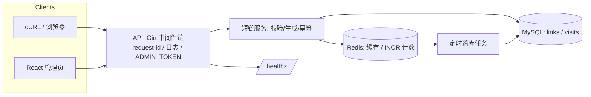

# SPEC-P0：短链服务

| 元信息 | 值 |
|---|---|
| 项目编号 | P0 |
| 所属阶段 | Phase 1（第 3-4 周，嵌入 2 周） |
| 状态 | Draft → **Review** → Frozen（终审后冻结） |
| 版本 / 日期 | v1.0 / 2026-10-09 |
| 作者 | A1 |

引用规则：本文件引用 `../../roadmap.md`（冻结基线）、`../../standards/project-acceptance-10.md`（验收）、`../../standards/code-quality.md`（代码规范）、`../../CLAUDE.md`（术语/资源池）。达标线见第 8 节。

## 1. 业务范围

一句话定位：一个用 Go 打造的短链服务——把长 URL 变短码、可过期、可统计点击，配 React 管理页；它是你的第一个可写进简历的 Web2 后端项目（roadmap 第 9 节）。

核心业务流程（编号化，供第 5 节架构图对照）：
1. **创建短链**：用户（curl 或管理页）提交长 URL → 校验（协议白名单/长度）→ base62 生成唯一短码 → 落库 `links`（幂等键 `client_token` 防重）→ 返回短链。
2. **访问跳转**：浏览器访问 `/links/{code}` → 查缓存（Redis，miss 则回源且回填）→ 校验过期 → `INCR` 点击计数 → 302 跳转长 URL；未命中/过期返回 404/410。
3. **统计与管理**：内置定时任务把 Redis 计数批量落库（≤ 60s 一致）；React 管理页展示列表（短码/长 URL/点击数/过期时间）并支持删除（删除同时失效缓存）。

## 2. 目标与边界

**Goals（本项目要做到的）**：
- G1：完整覆盖「REST API + MySQL 事务/索引 + Redis 缓存/计数 + Docker Compose + GitHub Actions + React 管理页」的最小全栈闭环（对应验收 ①④⑤⑥⑦⑧）。
- G2：短码生成、过期、点击统计三件核心业务逻辑可测试、可复述、可讲取舍（对应 ⑨⑩）。
- G3：成为 Phase 2 种子工程与 P2 旗舰项目「Go/MySQL/Redis/CI 写法」的先导模板（代码复用 `../../scaffolds/go-module.md`）。

**Non-Goals（明确不做，防止范围蔓延）**：
- NG1：不做用户登录与权限体系——管理接口用单一 `ADMIN_TOKEN` header 保护（威胁模型列入）。
- NG2：不做自定义短码、自定义域名、恶意链接检测（URL 黑名单）——入选的理由要写进 ADR。
- NG3：不做多租户、配额、批量导入导出。
- NG4：不做写真调试过调优——k6 只做冒烟（P50/P99 记录），调优对比是 P2 的事（roadmap 第 5 节）。

## 3. NFR（非功能需求）

| 类别 | 指标 | 目标值 | 测量方式 |
|---|---|---|---|
| 性能 | 跳转接口延迟 | P50 ≤ 15ms、P99 ≤ 100ms @ 200 并发 | k6 冒烟脚本（`../../scaffolds/k6`），结果入 README 成果清单 |
| 一致性 | 短码唯一 | `links.code` 唯一约束保证（并发创建不重复） | 并发创建测试 + 唯一约束 DDL |
| 一致性 | 计数一致性 | Redis INCR 与 MySQL 落库 ≤ 60s 对齐 | 多刷后对比 Redis 数值与 visits 表数字的记录 |
| 幂等 | 创建幂等 | 重复 `client_token` 返回 409（不重复建码） | 重复投递测试用例 |
| 安全 | 注入与越权 | URL 仅 http/https 协议白名单；管理删除需 ADMIN_TOKEN | 校验测试 + 威胁模型文档 |
| 可观测 | 日志/指标 | 结构化日志（zap）+ request-id 贯穿全链 | 日志断言用例 + README 说明 |

## 4. 技术栈（版本锁定）

| 组件 | 选型 | 版本 | 用途 | 备注 |
|---|---|---|---|---|
| 语言 | Go | 1.22+（go.mod 锁定本机实际版本） | 主线 | CI 中 setup-go 同版本 |
| Web 框架 | Gin | v1.9.x | HTTP API | 与 `../../scaffolds/go-module.md` 一致 |
| 数据库 | MySQL | 8.0（A2 compose 锁定 `../../scaffolds/docker-compose.md`） | 业务主存储 | 密码/库名走 .env |
| 缓存/计数 | Redis | 7.4-alpine（同上锁定） | 旁路缓存 + INCR 计数 | |
| 前端 | React + Vite | 最新稳定 | 管理页 | 锁 package-lock.json |
| 部署 | Docker Compose + GitHub Actions | — | 环境与 CI | 四步流水线模板 `../../scaffolds/ci-github-actions.md`；`../../standards/code-quality.md` 1.7 |

约束：中间件版本与 `../../scaffolds/docker-compose`（A2 交付正式版）基线一致；新增组件必填「备注」。

## 5. 架构图（Mermaid）

**组件职责表**：
- **API（Gin）**：路由 + 中间件链（request-id、zap 访问日志、panic 恢复、ADMIN_TOKEN 保护管理路由）；输入输出：HTTP JSON ↔ 业务层。
- **短链服务**：参数校验（协议白名单）、短码生成（base62）、幂等键判定；调用 store 与 cache。
- **MySQL**：`links` / `visits` 持久化；唯一约束（code、client_token）与索引（visits.link_id）。
- **Redis**：`link:{code} → url` 旁路缓存（TTL）、`visits:{code}` INCR 计数；写路径「先库后删缓存」。
- **定时落库任务**：每隔 ≤ 60s 把 Redis 计数批量写回 `visits` 并清计数键（单实例，启动于 main）。

**关键数据流**（与第 1 节编号对应）：
- D1（创建）：UI/cURL → API 校验 → 短码生成 → INSERT `links`（重复 client_token 由唯一约束抛 409）→ 返回 `{code, short_url, expires_at}`。
- D2（访问）：浏览器 `GET /links/{code}` → Redis 命中（回填不命中时回源）→ 过期校验（410）→ `INCR visits:{code}` → 302 + `Location`。

## 6. 数据模型要点

- **links 表**：`id BIGINT AUTO_INCREMENT PK`、`code VARCHAR(32) UNIQUE NOT NULL`（短码）、`url TEXT NOT NULL`（超长容忍）、`client_token VARCHAR(64) NULL UNIQUE`（幂等键，NULL 允许多行）、`expires_at DATETIME NULL`（NULL=永不过期，不用 2038 怪值）、`created_at / updated_at`。命名遵守 `../../standards/code-quality.md` 1.1。
- **visits 表**：`id BIGINT PK`、`link_id BIGINT NOT NULL`（FK → links.id，建索引）、`ip VARCHAR(45)`、`user_agent VARCHAR(255)`、`created_at`；点击计数按日聚合放 `link_visits_daily(link_id, day, cnt)` 可选（弹性项）。
- **幂等键设计**：`client_token` 由调用方生成，落 `links` 唯一约束——重放返回 409 而非双建（对应 NFR「幂等」）。
- Kafka 与链上：本项目无（Phase 2 起出现）。

## 7. 里程碑 M1-M4

> 每里程碑：目标 / 关键任务（引用 `../../01-go-web2/tasks.md` 编号）/ 退出条件（布尔，与验收勾选一致）。时长按标准档项目块（2h/天 × 12 天）估算，允许滑移 1 天，不可滑出第 4 周。

### M1：模型与 API（第 3 周前 3 天项目块）
- 目标：短链「可创建、可跳转」——最小全链路先通（跑通优先，roadmap 第 7 节）。
- 关键任务：T-09（建表迁移、创建/跳转 API、错误模型、base62 复用 T-02）。
- 退出条件：
  - [ ] docker compose up -d 后迁移脚本执行成功，`SHOW TABLES` 输出包含 links 与 visits 两表（输出存档）
  - [ ] `POST /api/v1/links` 合法请求返回 201 且 body 含 code；重复 client_token 返回 409（两组 curl 输出存档）
  - [ ] `GET /api/v1/links/:code` 返回 302 且 `Location` 为原 URL；不存在的 code 返回 404（输出存档）
  - [ ] 非法 URL（非 http/https 协议）返回 422，且存在对应命名测试
  - [ ] `go test -race ./...` 全绿输出存档

### M2：Redis 缓存与计数（第 3 周后段-第 4 周前段，约 3 天项目块）
- 目标：跳转快、计数准——读路径进缓存，计数 INCR 后定时落库。
- 关键任务：T-12（旁路缓存、过期 410、计数落库任务、删除失效缓存）。
- 退出条件：
  - [ ] 同一 short code 第二次访问时日志或调试输出含 cache hit 标记（输出存档）
  - [ ] 连续访问同一短码 N 次后，Redis `GET visits:{code}` 为 N 且 ≤ 60s 内 `visits` 表计数增 N（对比记录带时间戳）
  - [ ] 在 expires_at 过期时间之后访问返回 410（或 404），存在对应测试
  - [ ] 删除短码后访问返回 404 且 Redis 中缓存键已不存在（`DEL` 联动验证输出）

### M3：管理页与 CI（第 4 周中段，约 3 天项目块）
- 目标：React 管理页可操作、CI 流水线把关。
- 关键任务：T-13（管理页、ADMIN_TOKEN、四步流水线、API 文档）。
- 退出条件：
  - [ ] 管理页可创建短链、列表显示短码/长 URL/点击数/过期时间、可删除短链（录屏或分步截图存档）
  - [ ] 管理接口未带 `ADMIN_TOKEN` 请求返回 401，带正确 token 返回 200（curl 输出存档）
  - [ ] 四步流水线（lint/test/coverage/build）push 即触发且最近 10 次全绿，绿标截图存 README「CI」节；覆盖率为强制门禁（阈值脚本 ≥80%）
  - [ ] README（或 docs/api.md）含全部接口的请求/响应示例

### M4：验收（第 4 周后段，约 2-3 天项目块）
- 目标：10 条验收 ≥ 8 条达标，证据齐、能讲。
- 关键任务：T-14（验收自测、k6 冒烟、录屏、文档四件、QA 留痕）。
- 退出条件：
  - [ ] 第 8 节验收表 ≥ 8 行勾选，勾选版内嵌 README「验收」节
  - [ ] demo/ 下存在 3-10 分钟录屏（三幕完整）与 demo/script.md 分镜脚本
  - [ ] docs/review.md 含 ≥3 坑（现象/根因/解法/耗时）与 ≥2 取舍（选项对比/理由/重来）
  - [ ] 结论写入 `../../QA/review-log.md`，阶段收尾 commit 为 `chore: mark phase 1 checklist complete`

## 8. 验收勾选表（引用 10 条标准明细）

> 判定细则见 `../../standards/project-acceptance-10.md`。P0 达标线：**10 行中至少 8 行勾选完成**；②③ 两行提供 P0 简化判据（简化理由见下），若因客观条件无法勾选简化行，其余 8 行必须全勾。
> 简化理由：② 的「公网 URL」对第 4 周学员成本大于收益（P1 起再上公网）；③ 的服务端威胁模型在本项目缩写为轻量安全自查（完整威胁模型在 P2 执行）。

| # | 10 条标准 | 本项目判据（写完必须可勾选） | 证据位置 | 完成 |
|---|---|---|---|---|
| ① | 测试完备（≥80% + fuzz/边界） | `go test -cover ./...` 全仓 ≥80%（shortener + store 包 ≥90%），命令输出与截图入 README「测试」节；≥1 个 `FuzzXxx`（如短码编解码往返）本地跑 ≥1000 轮 0 失败记录在案；边界用例每项有命名测试（空 URL/超长 URL/非 http 协议/过期码/重复 client_token/并发同 token） | README + docs/test.md | [ ] |
| ② | 真实部署（testnet + 源码验证） | 简化判据：docs/deploy.md 含部署步骤与命令记录（含 .env.example 占位符清单）；README「部署」节给出「docker compose up -d → make migrate → make run」；验收当天 `curl http://localhost:8080/healthz` 返回 200 输出存档（公网隧道为加分项，完成则记入成果清单） | docs/deploy.md + README | [ ] |
| ③ | 安全自查（威胁模型） | 简化判据：docs/security.md 威胁模型覆盖 ≥3 类资产（短码滥用/计数篡改/管理接口越权）× 攻击面 × 缓解措施；URL 协议白名单与幂等防重（client_token 重复 409）各有测试；ADMIN_TOKEN 不进 git | docs/security.md + 测试 | [ ] |
| ④ | 文档齐备（架构图 + ADR） | README 含 Mermaid 架构图 ≥4 组件且带数据流方向；docs/adr/ ≥3 篇含背景/备选/决定/后果四要素，≥1 篇为「中途换方案」记录（如短码方案/计数落库方案/缓存失效方案中至少一篇写换案） | README + docs/adr/ | [ ] |
| ⑤ | 可演示（3-10 分钟录屏） | demo/ 录屏 3-10 分钟含三幕（启动→创建/跳转/统计→数据特写），配套 demo/script.md 分镜脚本 | demo/ | [ ] |
| ⑥ | 完整闭环（UI/CLI 走通全业务流） | 主流程：创建短链→访问跳转→管理页点击数变化，证据 = cURL 序列 + 录屏（demo/closed-loop.txt）；异常路径 ≥1 条有证据：过期码 410 / 重复 client_token 409 / 非法 URL 422 | demo/closed-loop.txt | [ ] |
| ⑦ | 可复现（依赖锁死 + 一键重跑） | go.mod/go.sum 与 package-lock.json 已提交；一条命令起全环境（docker compose up -d + make migrate + make run）；干净环境按 README 编号步骤 ≤30 分钟跑通并记录实测时长；清库方式（docker compose down -v + 重跑迁移）写入 README | README「快速开始」 | [ ] |
| ⑧ | CI 自动化 | workflow 含四步：lint（gofmt -l + go vet）→ test（go test -race ./...）→ coverage（阈值脚本 ≥80% 强制）→ build；最近 10 次 push 全绿截图存 README「CI」节（允许含 1 次失败→修复记录）；setup-go 版本与 go.mod 一致且有依赖缓存 | README「CI」节 | [ ] |
| ⑨ | 复盘文档（踩坑 + 取舍） | docs/review.md ≥3 坑（现象/根因/解法/耗时），≥2 取舍（选项对比表 + 选择理由 + 重来假设）；坑与 commit/日志日期可交叉验证 | docs/review.md | [ ] |
| ⑩ | 结果留痕（报告/地址/CI 截图） | README「成果清单」节：服务 URL、覆盖率数字、CI 绿标截图、录屏链接、k6 冒烟数字（并发数/延迟/错误率）逐项列出，验收当天每项可打开；本勾选表勾选版内嵌 README | README「成果清单」 | [ ] |

## 9. 周期估算与弹性

- 计划投入：2 周 × 6h/天（项目块 2h/天 ≈ 12 个项目块，M1-M4 各 3 天上下，M4 含验收缓冲）。
- 里程碑时间线：M1 截止第 3 周前段、M2 截止第 4 周前段、M3 截止第 4 周中段、M4 截止第 4 周后段（可整体滑移 ≤1 天，不可出第 4 周）。
- 可砍条目（最低档适用，标「弹性」）：管理页（弹性：可用 curl + 简单 HTML 表替代，退化为 CLI 闭环）；k6 冒烟（弹性：单组数据记录，不做调优）——见 roadmap 第 5 节最低档砍项。
- 红线：P0 属于 Phase 1（红线，roadmap 第 4 节）；10 条标准中的 ①④⑤⑥⑦⑧⑨⑩ 为强制（roadmap 第 5 节「任何档位不得砍」列表）。

## 10. 演示脚本页（录屏步骤，最终成片 3-10 分钟）

| 幕 | 时长 | 操作 | 预期画面/数据 | 讲解要点 |
|---|---|---|---|---|
| 第 1 幕 启动 | ~1min | `docker compose up -d` + `make migrate` + `make run` + `curl /healthz` | 三服务 healthy、迁移日志、healthz 200 | 环境架构一句话：API 接 MySQL 与 Redis |
| 第 2 幕 主流程 | ~4min | 创建短链（curl 与管理页各一次）→ 浏览器访问短链跳转 → 管理页刷新看点击数 +1 | 201 返回 code、302 Location、计数变化特写 | 每一步背后：校验→短码→索引；缓存命中→INCR |
| 第 3 幕 特写 | ~2min | 重复 client_token 请求 409；过期短码访问 410；日志显示 cache hit 与 request-id | 409/410 响应体、日志帧 | 幂等键=唯一约束（P1/P2 同模式预告）；缓存是加速不是正确性 |
| 第 4 幕 收尾 | ~1min | `go test -cover ./...` 与 CI 页面 | 覆盖率 ≥80% 数字、最近 10 次绿标 | 数字驱动收束：k6 P50/P99 一句话 |

约束：录屏含讲解或字幕；总时长 3-10 分钟；与 README「演示」节链接同一文件。

## 11. 变更记录

| 版本 | 日期 | 变更 | 作者 |
|---|---|---|---|
| v1.0 | 2026-10-09 | 初稿 | A1 |