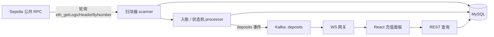

# SPEC-P1：链上充值监控服务

| 元信息 | 值 |
|---|---|
| 项目编号 | P1 |
| 所属阶段 | Phase 3（第 8-9 周） |
| 状态 | Draft → **Review** → Frozen（终审后冻结） |
| 版本 / 日期 | v1.0 / 2026-10-09 |
| 作者 | A3（Phase 3） |

## 1. 业务范围

一句话定位：P1 是交易所「充值钱包开发」岗位的缩小版——监听 Sepolia 上 USDC 的 Transfer 事件，把「打给我们自己的地址」的每一笔转账幂等地记入数据库，经历 pending / confirmed / finalized 状态机，reorg 时冲正，并实时推送到 React 面板。

核心业务流程（编号化，供第 5 节架构图对照）：
1. 扫块：轮询 Sepolia RPC，从安全高度（落后头块 ≥1）逐块拉取 USDC 合约日志，过滤接收地址 ∈ 我方 deposit address 集合。
2. 入账：对每笔匹配事件，以 (txHash, logIndex, 接收地址) 三元组为幂等键写入 deposits 表（pending 态）。
3. 状态推进：每个新块到达时为受影响充值更新确认数，按状态机迁移到 confirmed（≥6 确认）/ finalized（共识最终性）；检测到 reorg 时冲正（reversed）。
4. 通知：入账与状态变化以事件写入 Kafka `deposits` 主题；独立消费者驱动 WS 网关向订阅客户端推送快照与增量。
5. 查询与展示：REST 查询充值记录；React 面板实时展示充值到账与状态变化。

## 2. 目标与边界

**Goals（本项目要做到的）**：
- G1：Sepolia USDC 充值从广播到面板可见的完整链路可用（验收⑥⑩），并用一笔真实充值录屏留证（验收⑤）。
- G2：幂等与状态机经自动化测试证明正确：并发重投只入账一次、合法迁移全覆盖、reorg 冲正可演示（验收①③）。
- G3：扫块器写成可复用包 `internal/scanner`（RPC 封装 / 游标 / 安全边界 / 解析器），供 P2 钱包模块原样迁移（验收④⑨）。

**Non-Goals（明确不做，防止范围蔓延）**：
- NG1：不做自有全节点与节点运维——一律走公共 RPC（重试 + 退避应对限流）。
- NG2：不做多币种 / 多链——只做 Sepolia USDC（ERC-20），但解析器按 token 地址参数化，为多币种留扩展位。
- NG3：不做提现 / 归集 / 签名——那是 P2 钱包模块的事；本项目不接触任何私钥。
- NG4：不做行情相关功能（ticker / kline / depth）——那是 P2 M3。
- NG5：不做充值到账后的余额可用性判断与提现放行风控——本项目止步于「账务输入数据」，风控在 P2。

## 3. NFR（非功能需求）

| 类别 | 指标 | 目标值 | 测量方式 |
|---|---|---|---|
| 性能 | 扫块延迟 | 交易上链后 ≤ 30s 内入账（pending 可见） | 录屏时间线（区块时间戳 vs 面板出现时刻） |
| 一致性 | 强一致边界 | 入账 / 状态迁移 / 游标推进 在 MySQL 单事务内强一致；Kafka / WS 最终一致 | 单测 + 架构文档说明边界 |
| 一致性 | 幂等范围 | (txHash, logIndex, to_addr) 唯一约束兜底，重复投递与并发同键只入账一次 | 并发幂等测试 + 重复投递测试 |
| 安全 | 资金安全 | 无私钥参与；RPC URL 经环境变量注入，密钥零写入代码库与日志 | 威胁模型文档 + git 扫描 |
| 可观测 | 日志/指标 | 结构化日志含 blockNumber / txHash；扫块高度 metric | CI 检查 + 文档 |

## 4. 技术栈（版本锁定）

| 组件 | 选型 | 版本 | 用途 | 备注 |
|---|---|---|---|---|
| 语言 | Go | 1.2x（与 go.mod 一致） | 主线 | CI 中固定同版本 |
| Web 框架 | Gin | 同 P0 基线 | REST 查询 + 静态资源 | 与 scaffolds/go 骨架一致 |
| 链库 | go-ethereum | go.mod 锁定（如 v1.14.x） | RPC 客户端、ABI、类型 | 不跑自有节点 |
| 数据库 | MySQL | 8.x | deposits / deposit_addresses / scan_cursor | docker-compose 同版本 |
| 消息队列 | Kafka | 3.x | 入账事件流 | 主题见第 6 节 |
| 实时推送 | 自研 WS 网关 | — | 快照 + 增量 + seq 补偿 | `../../scaffolds/ws-gateway.md` |
| 前端 | React | P0 基线同版 | 充值面板 | 复用 P0 管理页经验 |
| 部署 | Docker Compose + GitHub Actions | — | 环境与 CI | 模板见 scaffolds |
| 链 | Sepolia | — | 测试网 | 水龙头见 `../../03-blockchain-indexer/resources.md` |

约束：中间件版本与 scaffolds/docker-compose 基线一致；不新增未在 `../../CLAUDE.md` 资源池内的依赖学习。

## 5. 架构图（Mermaid）

**组件职责表**：
- 扫块器 scanner：唯一接触 RPC 的组件。进：RPC 区块与日志；出：按区块号有序的解析后事件（同区块一次事务落库）与游标推进。
- 入账/状态机 processor：进：新块头与解析事件；出：deposits 表状态迁移、Kafka 事件。状态机逻辑为纯函数，数据是唯一真相。
- Kafka `deposits`：解耦「产生了事件」与「推送给谁」。事件：DepositSeen / DepositStatusChanged / DepositReversed（key = txHash:logIndex:to）。
- WS 网关：扇出通知。进：Kafka 消费者的消息；出：快照 + 增量帧（seq 递增）、断线重连补偿。
- REST：只读查询（GET /deposits，按 address / status / range 过滤）。
- React 面板：充值列表 + 状态徽章 + WS 实时刷新。

**关键数据流**（与第 1 节编号对应）：
- D1（流程 1-4）：RPC 区块 → scanner 解析 → processor 幂等入库（pending）→ 新块确认数更新迁移状态 → Kafka → WS 网关推送到面板。
- D2（流程 3 的 reorg 分支）：scanner 发现游标块 hash 与链不符或确认数回退 → processor 冲正：受影响 rows → reversed + 发 DepositReversed → WS 推送冲正帧。

**与 P2 的关系**：P2 钱包模块（充值 + 提现 + 对账）原样复用本项目 `internal/scanner`（RPC 封装 / 游标 / 落后保护 / 解析器）与状态机三态定义；deposits 表是 P2 账务的输入账。因此本项目是 P2 的硬前置（`../../roadmap.md` 第 4 节），红线不可砍，扫块逻辑必须以独立包 + 独立单测交付。

## 6. 数据模型要点

- 核心表（要点，完整 DDL 由学员实现；命名遵守 `../../standards/code-quality.md` 1.1）：
  - `scan_cursor`：单行（chain_id PK）。字段：chain_id, last_block_number BIGINT, last_block_hash CHAR(66), updated_at。作用：重启续扫与 reorg 检测的锚点。
  - `deposit_addresses`：我方接收地址名单。字段：address CHAR(42) PK, user_id BIGINT, status（active/disabled）, created_at。扫块过滤依据；面板「我的地址」来源。
  - `deposits`：充值流水。字段：id BIGINT AUTO_INCREMENT PK, tx_hash CHAR(66), log_index INT, block_number BIGINT, block_hash CHAR(66), token_address CHAR(42), from_addr CHAR(42), to_addr CHAR(42), value_raw DECIMAL(38,0), status ENUM('pending','confirmed','finalized','reversed'), confirmations INT, first_seen_at / status_updated_at；**UNIQUE KEY uk_deposits_key (tx_hash, log_index, to_addr)**。
- 金额精度：链上金额一律以整数原值存 `value_raw`（DECIMAL(38,0) 或 CHAR），USDC 的 6 位小数换算只发生在展示层；禁止浮点（`../../standards/code-quality.md` 与 10 条验收③的金额精度项）。
- 幂等键设计：idempotency key = (tx_hash, log_index, to_addr)，落在 `deposits` 唯一约束上；冲突时按「最新区块信息 UPDATE 确认数字段」处理（幂等 UPDATE），不新增行。
- 状态机：pending → confirmed(≥6) → finalized；pending/confirmed → reversed（冲正）。合法迁移表由 `../../03-blockchain-indexer/tasks.md` T-05 产出并进 README。
- 主题命名：`deposits`（事件流；本项目唯一主题，P2 沿用的账务输入主题）。

## 7. 里程碑 M1-M5

> 每里程碑：目标 / 关键任务（引用 `../../03-blockchain-indexer/tasks.md` 编号）/ 退出条件（布尔）。

### M1：扫块与事件解析（第 8 周项目块 + 第 9 周第 1 天）
- 目标：从 RPC 安全地拿到「打给我方地址」的 USDC Transfer 事件并落库。
- 关键任务：T-07（扫块器骨架 / 游标 / 落后保护）、T-08（解析器 / 过滤 / 半块与事务边界）。
- 退出条件：
  - [ ] 服务连续运行 10 分钟无错，`demo/m1-scan.log` 含 ≥1 个区块扫描记录
  - [ ] tip-lag 配置默认 ≥1，单测断言「目标块 = 头块 - tip-lag 时停止」
  - [ ] 重启续扫：两次运行日志证明无重复无跳块，游标表存 (blockNumber, blockHash)

### M2：状态机与幂等入账（第 9 周第 2-4 天）
- 目标：事件幂等入账，状态迁移正确且并发安全。
- 关键任务：T-09（迁移与幂等约束）、T-10（状态机实现 / 确认数循环 / 并发幂等测试）。
- 退出条件：
  - [ ] 每条合法迁移（pending→confirmed、confirmed→finalized、pending→reversed、confirmed→reversed）≥1 条命名测试，非法迁移返回 error 有测试
  - [ ] 10 个 goroutine 并发投递同一 (txHash, logIndex, to_addr)，`deposits` 恰好 1 行，`go test -race` 通过
  - [ ] 全仓覆盖率 ≥ 80%，关键包（scanner/processor/状态机）≥ 90%，输出与截图入 README

### M3：确认数与 reorg 冲正（第 9 周第 5 天）
- 目标：状态随确认数自动推进；reorg 产生冲正而不是错误数据。
- 关键任务：T-11（hash 不符检测 / 冲正事务 / 模拟 reorg 演示脚本）。
- 退出条件：
  - [ ] `docs/reorg-demo.sh` 按 `docs/reorg-demo.md` 可重复执行，`demo/reorg-demo.log` 含 status → reversed 迁移与冲正事件
  - [ ] 确认数更新循环单测覆盖「确认数 +1 到门槛」与「确认数回退」两路径

### M4：通知 / API / React 面板（第 9 周第 6-7 天）
- 目标：事件经 Kafka → WS 网关实时到达面板；REST 可查询。
- 关键任务：T-12（Kafka / WS 网关接入 / REST）、T-13（React 面板）。
- 退出条件：
  - [ ] 独立消费者消费 `deposits` 主题输出合法 JSON 事件（`demo/deposits-consumed.log`）
  - [ ] WS 断线重连带 lastSeq 重订阅补发增量：输出订阅前后 seq 序列，不重复不丢
  - [ ] `curl GET /deposits` 按 address / status 过滤返回正确（输出入 README）
  - [ ] 面板显示一笔充值及其状态变化（截图）

### M5：验收（第 9 周第 8 天 + 周日）
- 目标：10 条验收标准全勾并留痕。
- 关键任务：T-14（真实充值录屏 / CI 绿标 / coverage 证据）、T-15（勾选表 / 复盘 / 验收记录）。
- 退出条件：
  - [ ] README「验收」节 10 条全勾，每条附证据路径
  - [ ] `demo/p1-deposit.mp4` 3-10 分钟含真实 Sepolia 充值全流程
  - [ ] `docs/review.md` ≥3 坑 + ≥2 取舍；`../../QA/review-log.md` 追加 P1 验收记录

## 8. 验收勾选表（引用 10 条标准明细）

> 判定细则见 `../../standards/project-acceptance-10.md`。重点项加粗：真实充值录屏、状态机迁移测试覆盖率、reorg 冲正演示。

| # | 10 条标准 | 本项目判据（写完必须可勾选） | 证据位置 | 完成 |
|---|---|---|---|---|
| ① | 测试完备（≥80% + fuzz/边界） | 全仓 ≥ 80%，关键包（scanner/processor/状态机）≥ 90%；`FuzzParseTransferLog` 跑 ≥ 1000 轮 0 失败；边界用例（零金额/重复幂等键/topics 非法）各有命名测试 | README「测试」节截图 + docs/test.md | [ ] |
| ② | 真实部署（testnet + 源码验证） | 服务有公网可达 URL（VPS 或隧道），README 部署节记录 URL 与日期，验收当天可访问 | README「部署」节 | [ ] |
| ③ | 安全自查（威胁模型） | docs/security.md 覆盖 ≥4 项资产（充值入账、deposits 流水、WS 订阅连接、RPC 凭据）× 攻击面 × 缓解；资金必查项（幂等防重放/金额精度）有测试或书面说明 | docs/security.md | [ ] |
| ④ | 文档齐备（Mermaid + ADR） | README Mermaid 架构图 ≥4 组件含数据流方向；docs/adr/ ≥3 篇（含 1 篇中途换方案，如「纯轮询 → 轮询+订阅加速」）；README 四节齐 | README + docs/adr/ | [ ] |
| ⑤ | 可演示（3-10 分钟录屏） | **`demo/p1-deposit.mp4` 3-10 分钟**：启动 → 真实 Sepolia 充值入账 → WS/面板特写 → 测试与 CI 收尾；配套 demo/script.md 分镜 | demo/ | [ ] |
| ⑥ | 完整闭环（UI 走通全业务流） | **主流程：MetaMask 转账 1 USDC → 服务入账 → 面板/WS 可见**；异常路径 ≥1 有证据（重复投递被幂等拦截的日志或测例）；**reorg 冲正演示（reversed 路径）** | demo/p1-deposit.mp4 + demo/reorg-demo.log | [ ] |
| ⑦ | 可复现（一键重跑） | go.mod/go.sum、package-lock.json 已提交；`docker compose up -d` 一条命令起 MySQL/Kafka；全新环境按 README ≤ 30 分钟跑通 | README「快速开始」 | [ ] |
| ⑧ | CI 自动化 | .github/workflows/ci.yml 四步（lint+test+coverage+build），覆盖率 < 80% 即红；最近 10 次 push 全绿截图 | README「CI」节 | [ ] |
| ⑨ | 复盘文档（踩坑 + 取舍） | docs/review.md ≥3 坑（现象/根因/解法/耗时）+ ≥2 取舍（选项对比表/理由/重来），可改写成 2 分钟面试故事 | docs/review.md | [ ] |
| ⑩ | 结果留痕 | README「成果清单」节：服务 URL、coverage 数字与截图、CI 绿标、demo/p1-deposit.mp4、parse-transfer.json 链接全部可打开；10 条勾选在 README 内嵌 | README + ../../QA/review-log.md | [ ] |

## 9. 周期估算与弹性

- 计划投入：2 周 × 6h/天；项目实际投入 ≈ 48h（W8 项目块 12h + W9 约 33h + 周日上午 3h）。
- 里程碑时间线：M1 截止 W9 第 1 天末；M2 截止 W9 第 4 天末；M3 截止 W9 第 5 天末；M4 截止 W9 第 7 天末；M5 截止 W9 周日。
- 可砍条目：**无**——P1 是 `../../roadmap.md` 第 4 节红线项目，任何档位不得砍；最低档以压缩每日深度应对（选读资源全跳过、周日上午并进验收）。
- 提速提示（冲刺档）：M4 的 WS 网关直接使用 `../../scaffolds/ws-gateway.md` 的接口骨架，不自己重新设计协议。

## 10. 演示脚本页（录屏步骤，最终成片 3-10 分钟）

| 幕 | 时长 | 操作 | 预期画面/数据 | 讲解要点 |
|---|---|---|---|---|
| 第 1 幕 启动 | ~1min | `docker compose up -d` + `make migrate` + `make run` | MySQL/Kafka 容器就绪、服务日志出现扫块循环、GET /health 200 | 架构一句话：扫块 → 入账 → Kafka → WS → 面板 |
| 第 2 幕 主流程 | ~4min | MetaMask 向自己的 deposit address 转 1 USDC（Sepolia） | 浏览器交易确认 → 服务日志打印解析结果 → 面板出现 pending 并翻转为 confirmed → WS 帧展示 | 每一步在哪一站：广播→mempool→打包→确认；幂等键为什么是三元组 |
| 第 3 幕 特写 | ~2min | ①重复投递同一笔充值（脚本重放攻击路径）；②执行 `docs/reorg-demo.sh` | ①数据库仍 1 行、面板无重复；②日志出现 confirmed → reversed 冲正事件、面板状态徽章变红 | 幂等唯一约束兜底；reorg 为什么会发生、冲正怎么保证不双重记账 |
| 第 4 幕 收尾 | ~1min | `go test -cover ./...` + 打开 CI 页面 | 覆盖率 ≥ 80%（关键包 ≥ 90%）数字特写、最近 10 次 push 全绿 | 数字收束：这个项目的质量防线分层 |

约束：录屏含讲解或字幕；总时长 3-10 分钟；与 README「演示」节链接同一文件。

## 11. 变更记录

| 版本 | 日期 | 变更 | 作者 |
|---|---|---|---|
| v1.0 | 2026-10-09 | 初稿 | A3 |