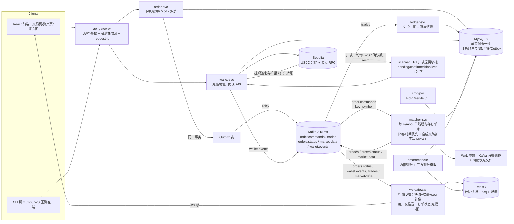

# SPEC-P2：迷你交易所（旗舰项目）

| 元信息 | 值 |
|---|---|
| 项目编号 | P2 |
| 所属阶段 | Phase 4（第 10-14 周） |
| 状态 | Draft → **Review** → Frozen（终审后冻结） |
| 版本 / 日期 | v1.0 / 2026-10-09 |
| 作者 | A4b |

> 行内引用：`../../roadmap.md`（冻结基线，其 Phase 4 一节是本 SPEC 的上位约束）、`../../standards/project-acceptance-10.md`（10 条验收）、`../../standards/code-quality.md`（Go 代码规范）、`../../CLAUDE.md`（术语/资源池）。
> 基线前置：roadmap 依赖关系 P3→P4 为硬依赖——P2 钱包模块直接复用 P1 的扫块/确认数/reorg 冲正逻辑。P1 SPEC 落盘后如与本文件对充值入账时点的约定冲突，以冻结后的 P1 SPEC 为准，差异记录到 `../../QA/review-log.md`。
> 本文件只定义「做什么、验收什么、怎么算对」，不给业务源码；实现要点、测试期望与常见坑见 Phase 4 四件套的 `lecture.md` / `tasks.md`（本 SPEC 第 7 节任务项与阶段 tasks.md 编号的对应表，待 tasks.md 冻结后在 `../../QA/review-log.md` 回填）。

## 1. 业务范围

一句话定位：**一个跑在 Sepolia 测试网上的现货迷你交易所**——用户注册登录后拥有三栏账户（冻结/可用/总额），对 USDC/USDT 交易对下单，经内存订单簿撮合成交，账务复式记账，行情经 WS 网关推送（快照+增量+seq 补偿），链上 USDC 可真实充值、可真实提现，冷热钱包分层归集，内部与三方对账零差异，PoR 简化 Merkle CLI 可审计。它为「撮合引擎 / 三栏账务 / 订单流拓扑（Kafka+WS 网关）/ 充提确认与安全 / 三方对账 / 冷热钱包 / 低延迟优化」七类系统设计题提供实战素材（对应 roadmap 第 8 节系统设计 8 题中的①②③④⑤⑥⑦）。

核心业务流程（编号化，供第 5 节架构图对照）：

1. **注册登录**：邮箱+密码注册（bcrypt 存储）→ 签发 JWT → 后续所有接口携带；网关做 JWT 鉴权与令牌桶限流。
2. **下单→撮合→结算**：用户提交限价/市价单 → 订单服务校验（余额、风控额度）并在**同一 MySQL 事务**内写入订单（状态 NEW）+ 冻结资金 + Outbox 事件 → relay 投递 Kafka（key=symbol）→ 撮合引擎按 symbol 单线程消费：价格-时间优先匹配、自成交防护 → 每笔成交发 `trades` 事件 → 账务服务幂等消费，复式记账更新双方三栏（释放冻结、入可用）。
3. **撤单**：请求撤单 → 订单服务锁定订单行校验可撤 → Outbox 发 CANCEL 命令 → 撮合引擎串行处理（与同 symbol 的成交事件天然排他）→ 终态 CANCELED + 解冻回可用。
4. **行情推送**：撮合引擎把深度增量/成交/最新价发 `market-data` 主题 → 行情 WS 网关维护每 symbol 每通道单调 seq → 客户端订阅先收快照再收增量；断线重连检测 seq 缺口，请求 resync 补偿。
5. **充值**：钱包服务移植 P1 扫块逻辑（轮询+WS、确认数 pending/confirmed/finalized、reorg 冲正）→ 按幂等键 `(tx_hash, log_index, address)` 唯一入账 → 复式记账（链外入账）→ `wallet.events` → WS 网关推送到户。
6. **提现**：发起提现（available→frozen 防重复）→ 风控规则校验 → 批准 → ECDSA 签名（热钱包私钥）→ 广播 `eth_sendRawTransaction` → 回执状态机 BROADCASTED → CONFIRMED（按确认数），失败/拒绝则冲正解冻。
7. **对账与 PoR**：内部对账（复式记账借贷恒等 + 账户三栏与流水重演一致）与三方对账（内部账本 / 链上记录 / 钱包方记录模拟）输出零差异报表；PoR 简化版 Merkle CLI（快照→根→用户证明→校验，叶子总额对比冷钱包余额）。

**交易对决策（冻结）**：上线 USDC/USDT（base=USDC，quote=USDT）单一交易对。USDC 为唯一链上资产（Sepolia 真实充提）；USDT 为内部测试资产，由本所**faucet 端点**发放（每用户一次，上限 5,000 USDT，见第 6 节），在 README 与代码注释中明确标注「USDT 为测试资产、无链上背书」。分层理由：多链上资产会把扫块、提现、归集的 scope 翻倍，而「一个链上资产 + 一个内部资产」已覆盖全部账务与钱包机制；架构按 symbol 分片，增加交易对是配置级扩展（见 Non-Goal NG4）。

## 2. 目标与边界

**Goals（本项目要做到的）**：

- G1：完整业务闭环可跑：注册 → Sepolia 真实充值 USDC → 限价/市价下单 → 撮合成交 → 行情 WS 实时可见 → 提现上链拿到 CONFIRMED 回执（10 条验收⑤⑥全勾）。
- G2：撮合与账务正确性有机器可查的证据：fuzz 不变式（自成交为零、价差不交叉、成交量守恒）、并发守恒测试、对账 CLI 零差异报表（验收①⑨⑩都能给出具体数字）。
- G3：性能数字驱动：撮合单 symbol 纯撮合峰值 ≥ 50,000 单/s（内存 bench）、下单接口 P99 < 100ms、行情推送 P99 < 200ms，k6 三组数据 + pprof 调优前后对比（验收⑩）。
- G4：工程素质项全绿：CI 四步门禁、依赖锁死可复现、密钥零泄漏、威胁模型、ADR、复盘文档（验收③④⑦⑧）。

**Non-Goals（明确不做，防止范围蔓延）**：

- NG1：**不做衍生品/杠杆/实时结算**——无合约、无强平、无资金费率，全部为现货 T+0；不做多级费率与返佣（本所手续费恒为 0，trades 表预留 fee 字段）。
- NG2：**不做多级撮合中心/跨所路由/做市商策略**——单进程单 symbol 内存订单簿；不承诺 1ms 级极速链路，撮合峰值目标只是「内存纯撮合 ≥ 5 万单/s」。
- NG3：**不做 MPC 真托管/HSM/多方签名**——冷钱包签名用「离线 CLI 手工签名 + 热服务加载签名文件」模拟；私钥仅控制测试网资金（README 声明边界，不承担真实资金安全）。
- NG4：**只上线 USDC/USDT 一个交易对**，不做多币种；架构按 symbol 分片 + Kafka 按 symbol 分区，新增交易对是配置与主题分区扩展，本课程不落地第二个对。
- NG5：**不做 kline 与复杂行情指标**——行情只有 ticker（24h 汇总）、depth（聚合档位）与 trade tape 三类；不做短信/邮箱验证与 KYC 实名，登录=邮箱+密码，风控为可枚举规则集。
- NG6：**不做高可用主备/多机房**——单实例部署（本地 docker compose + 公网隧道），高可用属于系统设计题素材（roadmap 8 题⑧），不在本项目范围。

**背景与对照（为什么不复用老牌开源 CEX，也不自研一切）**：老牌开源 CEX 项目（如 Peatio、OpenDAX 一类）代码库年代久远、语言与中间件栈（Ruby/私有 MQ）与本课程冻结的 Go+Kafka 现代栈不一致，也不符合「现货撮合为面试主线」的覆盖度，故仅作背景反例，不作为教程与资源链。（本段为黑名单允许的「背景参考」段落，见 CLAUDE.md 第 2 节。）现代撮合实现可对照以下选读参考：LMAX 架构（必读，低延迟单线程模型出处）、exchange-core（Java 撮合对照）、Go orderbook 与中文 trading_engine（Go 对照）——全部来自已核实资源池，只读代码结构与设计取舍，禁止复制代码。

## 3. NFR（非功能需求）

| 类别 | 指标 | 目标值 | 测量方式 |
|---|---|---|---|
| 性能 | 撮合引擎单 symbol 纯撮合峰值 | ≥ 50,000 单/s（本机 M 系 Mac，内存） | `cmd/bench` 直灌内存订单簿（不含 Kafka/MySQL），输出入 README 压测节 |
| 性能 | 下单接口端到端（202 Accepted 响应） | P99 < 100ms @ 并发 500（本机 docker compose 全家） | k6 脚本 `scaffolds/k6/orders.js`，报告入 README |
| 性能 | 行情推送端到端（撮合成交 → WS 客户端收到帧） | P99 < 200ms | 自制 WS 打点客户端 `scripts/ws-latency.go` 统计 1000 笔成交 |
| 性能 | 压测组数 | k6 三组数据（下单 RPS / WS P99 / 撮合峰值）+ pprof 调优前后对比表 | 先基线后调优，两组数据对比入 README |
| 一致性 | 强一致边界 | 三栏变更与分录在同一 MySQL 事务内（单实例强一致）；订单状态经事件回写（最终一致，REST 查询允许短滞后） | 并发守恒测试 + 对账 CLI 零差异 |
| 一致性 | 行情一致性 | 最终一致：增量最终到齐，seq 无缝衔接 | 断线重连 + 抖动注入的 seq 补偿测试 |
| 一致性 | 幂等范围 | 充值 `(tx_hash, log_index, address)`；下单 `(uid, client_order_id)`；提现 `(uid, request_id)`；账务消费 `(biz_type, ref_id, uid, seq)` | 重复投递测试用例（每类幂等键至少 1 个） |
| 安全 | 资金安全 | 私钥与助记词不进 git、不进日志；提现必须过风控+签名；余额变更必须在事务内 | docs/security.md 威胁模型 + 密钥扫描脚本 + 越权测试 |
| 可观测 | 日志 / 指标 | 结构化日志（JSON）+ request-id；核心指标进 Prometheus（撮合速率、Kafka 队列深度、WS 连接数、账务处理延迟） | 指标端点 + 文档说明 |

## 4. 技术栈（版本锁定）

| 组件 | 选型 | 版本 | 用途 | 备注 |
|---|---|---|---|---|
| 语言 | Go | 1.22+（具体版本与 go.mod 锁定一致，README 注明） | 全部服务 | CI 中 actions/setup-go 同版本 |
| Web 框架 | Gin | v1.9.x | HTTP API（网关与各服务） | 与 seeds 工程骨架一致 |
| 数据库 | MySQL | 8.0（8.x 最新稳定） | 业务主存储（订单/账户/分录/充提） | docker-compose 同版本 |
| 缓存/锁/快照 | Redis | 7.2.x | 令牌桶限流、行情快照+seq、登录尝试计数 | |
| 消息队列 | Kafka | 3.7.x（KRaft，单节点无 ZooKeeper） | 命令流/成交/行情/钱包事件 | 主题命名见第 6 节 |
| 链 | Sepolia（Sepolia USDC） | — | 真实充提演示 | 幂等键、确认数、reorg 语义见第 6 节 |
| 链库 | go-ethereum | v1.14.x | RPC 客户端（扫块/发送交易/签名） | 只读链接：Geth 文档（必读） |
| 签名库 | go-ethereum crypto + types | 同上 | EIP-155 交易构造与签名 | 私钥仅环境变量注入 |
| JWT | golang-jwt/jwt | v5 | 登录会话 | 短期 token（见第 6 节安全说明） |
| WebSocket | gorilla/websocket | v1.5.x | 行情 WS 网关 | 服务端与压测客户端共用 |
| 前端 | React + Vite + TypeScript | React 18 / Vite 5 / TS 5.x | 交易页/资产页 | 深度图用 lightweight-charts |
| 图表 | lightweight-charts | v4.x | 深度图（阶梯面积）+ 成交 tape | 见第 7 节 M5 |
| 压测 | k6 | v0.49+ | 三组压测 | k6 文档（必读） |
| 性能剖析 | pprof（net/http/pprof） | Go 标准库 | cpu/heap profile 调优 | pprof 文档（必读） |
| CI | GitHub Actions | ubuntu-latest | 四步门禁 | GitHub Actions 文档（必读） |
| 部署 | Docker Compose | v2 | 全环境一键起 | Docker 文档（必读） |

约束：中间件版本与 `scaffolds/docker-compose` 基线一致；新增组件必须回填本表「备注」。所有库依赖以 go.mod/go.sum、package-lock.json 锁定（验收⑦）。

**服务拆分与端口（冻结）**：全部为独立进程、共享同一 MySQL 实例，docker compose 管理。

| 服务 | 端口 | 职责 |
|---|---|---|
| api-gateway | 8080 | JWT 鉴权 + 令牌桶限流 + request-id 中间件；注册/登录；REST 路由（订单/钱包/行情查询，转发各服务 HTTP）；托管前端构建产物（演示用） |
| order-svc | 8081 | 下单/撤单/订单查询；冻结（同事务）；Outbox 写入；消费 `orders.status` 事件回写订单终态 |
| matcher-svc | 8082 | 消费 `order.commands`；每 symbol 单线程内存订单簿；产出 `trades`/`orders.status`/`market-data`；快照与重放 |
| ledger-svc | 8083 | 消费 `trades` 幂等复式记账；对账 CLI 的宿主（`cmd/reconcile` 独立入口） |
| ws-gateway | 8084 | 行情 WS（快照+增量+seq 补偿）；消费 `market-data`/`trades`/`wallet.events`/`orders.status`；Redis 快照与 seq；按用户推送充提/订单事件 |
| wallet-svc | 8085 | 充值：P1 扫块移植（轮询+WS/确认数/冲正/幂等入账）；提现：风控→批准→签名→广播→回执状态机；归集：deposit→hot→cold、cold→hot 补液 |
| React 前端 | 5173（dev）/ 由网关托管（演示） | 交易页/资产页/深度图 |
| MySQL / Redis / Kafka | 3306 / 6379 / 9092 | 基础设施，docker compose |

## 5. 架构图（Mermaid）与数据流

**组件职责表**（职责 + 数据进出）：

| 组件 | 职责 | 数据进 | 数据出 |
|---|---|---|---|
| api-gateway | 鉴权/限流/路由；注册登录 | 用户 HTTP 请求 | JWT；转发到 order-svc / wallet-svc；静态前端 |
| order-svc | 下单校验与冻结、撤单、订单查询、Outbox | HTTP + MySQL | Outbox 行 → `order.commands`；消费 `orders.status` 回写 |
| matcher-svc | 内存撮合（价格-时间优先、自成交防护）、快照与重放 | `order.commands` | `trades` / `orders.status` / `market-data` |
| ledger-svc | 复式记账唯一写入方（订单结算） | `trades` | MySQL ledger_entries + accounts 更新 |
| ws-gateway | 行情快照/增量/seq 补偿；用户级推送 | `market-data` / `trades` / `wallet.events` / `orders.status`；Redis | WS 帧（snapshot/update/trade/ticker/order/deposit） |
| wallet-svc | 扫块入账（P1 移植）、提现状态机、归集、冷签 CLI | 链事件扫描、HTTP、MySQL | `wallet.events`；链上交易；
| scanner（P1 移植） | 轮询+WS 扫块、确认数、reorg 冲正 | RPC 节点 | DepositEvent → wallet-svc 入账 |
| cmd/reconcile | 内部对账 + 三方对账模拟 | MySQL + Redis 快照 | 差异报表 CSV（docs/reconcile/） |
| cmd/por | PoR Merkle 快照/根/证明/校验 | MySQL accounts | 审计报告 docs/por/ |

**关键数据流**（与第 1 节编号对应）：

- D1（流程 2 下单链路）：`POST /api/v1/orders`（JWT 鉴权，经网关）→ order-svc 事务：`SELECT account FOR UPDATE` 校验余额与风控额度 → 写 orders(NEW) + 更新 available/frozen + 写 outbox → 事务提交 → relay 批量投递 `order.commands`（key=symbol，模拟单`{action:"NEW", order_id, symbol, side, type, price_minor, qty_minor / quote_amount_minor}`）→ matcher 匹配 → `trades` 每笔成交 `{trade_id, symbol, price_minor, qty_minor, quote_amount_minor, maker_order_id, taker_order_id, maker_uid, taker_uid, ts}` → ledger-svc 消费（幂等键 `(biz_type='SETTLE', ref_id=trade_id, uid, seq)`）→ 同事务更新双方 accounts + 写分录 → order-svc 消费 `orders.status` 幂等回写订单终态。
- D2（流程 3 撤单链路）：`POST /api/v1/orders/{id}/cancel` → order-svc `SELECT ... FOR UPDATE` 校验归属与状态（仅 NEW/PARTIALLY_FILLED 可撤）→ 写 outbox（CANCEL）→ matcher 在其 symbol 队列中依序处理：book 中仍存活则移除并解冻，若已成交变终态则 CANCEL 事件被忽略 → `orders.status` 回写 + 解冻分录（记账服务）。
- D3（流程 4 行情链路）：matcher 内部每次 book 变更/成交即发 `market-data` 增量 `{symbol, seq, channel:"depth"|"trade"|"ticker", data}` → ws-gateway 维护每 symbol 每通道 seq（Redis INCR）与环形缓冲（最近 10,000 帧）→ 新连接发 `snapshot` 帧（seq 起点）+ 增量；客户端检测缺口发 `{op:"resync", from_seq}` → 网关回放环形缓冲（不足时从 DB trades/orders 重放补齐）。
- D4（流程 5 充值链路）：scanner 扫到 USDC `Transfer` 事件 → wallet-svc 幂等键 `(tx_hash, log_index, address)` 唯一约束落 deposit 行（pending→confirmed≥2 确认→finalized≥12 确认；入账发生在 confirmed，数字以冻结后的 P1 SPEC 为准）→ 同事务写 ledger DEPOSIT 分录（CHAIN_IN → available）→ `wallet.events` → ws-gateway 推送 `deposit` 帧到该 uid。
- D5（流程 6 提现链路）：`POST /api/v1/wallet/withdrawals`（`(uid, request_id)` 幂等）→ available→frozen → 风控规则（见第 6 节）→ APPROVED → 热钱包签名（EIP-155，nonce 管理）→ `eth_sendRawTransaction` → BROADCASTED → 回执轮询确认数（演示配置 `WITHDRAW_CONFIRMATIONS=1`，默认可配）→ CONFIRMED 终态（frozen→CHAIN_OUT 分录）；REJECTED/FAILED 冲正（frozen→available，分录 WITHDRAW_REVERSAL）。
- D6（流程 7 对账/PoR）：内部对账按日窗口重演 ledger（Σ借==Σ贷、账户三栏==分录投影）；三方对账（USDC）：内部总资产 vs 链上净入金（confirmed 充值 - confirmed 提现）vs 钱包方记录（hot+cold+sweep 台账）；对账差异 = 0 才算绿，差异注入测试保证工具能检出差异。PoR：叶子 = (uid, total_minor)，SHA-256 双节点 Merkle，CLI 可出根/证明/校验，并对比叶子总额 vs 冷钱包余额（docs/por/audit.md）。

## 6. 数据模型要点

> 金额与价格统一约定（冻结，贯穿撮合/账务/充提）：**全部为 int64 最小单位整数**——USDC/USDT 数量 `qty_minor`（1e6 缩放，6 位小数），价格 `price_minor`（1e8 缩放，8 位小数）。撮合与账务只做整数乘除，成交报价金额 `quote_amount_minor = floor(price_minor * qty_minor / 1e8)`（floor 向下取整，买卖双方取同一值，无残差）。溢出防护：下单前校验单笔名义价值 ≤ 50,000 USDC（风控常量 `MaxOrderNotionalMinor`），保证 `price_minor × qty_minor` 远低于 int64 上限；边界单测覆盖此值。此约定在 README 与 ADR-00x 说明（为什么十进制浮点与 float64 都是禁区，为什么单笔限额同时是风控与溢出防护）。

- **users** — 注册登录。字段：`id, email(UNIQUE), password_hash, created_at`。索引：`UNIQUE(email)`。JWT 用 HS256 短期 token（15 分钟），密钥经环境变量注入（不进 git/日志）；不做 refresh 轮换（Non-Goal NG5）。

- **accounts** — 三栏账户，每 (uid, asset) 一行。部署资产：`USDC`（链上，6 位小数）、`USDT`（内部测试，6 位小数）。字段：`id, uid, asset, available_minor, frozen_minor, total_minor, updated_at`。索引：`UNIQUE(uid, asset)`。**不变量（每笔变更同一事务内成立）：total == available + frozen**；任何一次业务变更 <=> 一组复式记账分录，二者同事务写入。初始状态：注册时 USDC=0；faucet 端点首次领取 USDT 时 `DEPOSIT` 类分录（来源标注 FAUCET）+ 幂等约束（uid 唯一发一次）。

- **ledger_entries** — 复式记账分录，只增不删不改。字段：`id, tx_no（一批分录共享批号）, uid, asset, amount_minor, from_loc, to_loc, biz_type, ref_type, ref_id, seq, created_at`。`from_loc/to_loc ∈ {AVAILABLE, FROZEN, CHAIN_IN, CHAIN_OUT, FAUCET}`（栏间划转与链外/发放方向）。`biz_type ∈ {FREEZE, UNFREEZE, SETTLE, DEPOSIT, WITHDRAW, WITHDRAW_REVERSAL}`。索引：`UNIQUE(biz_type, ref_id, uid, seq)`（账务消费幂等键，重复事件插入冲突即跳过）；`KEY(ref_type, ref_id)`（对账重演）。守恒断言（对账 CLI 与测试共用）：任意窗口 Σfrom == Σto；账户三栏 == 分录投影（panel 变换）；每笔业务至少一组借方贷方（存款一笔 CHAIN_IN→AVAILABLE 单行借外帐亦可，但冻结/结算/冲正必为成对栏目）。

- **orders** — 订单。状态机（冻结字面：NEW → PARTIALLY_FILLED → FILLED / CANCELED / REJECTED；REJECTED 仅从 NEW 进入；CANCELED 允许从 NEW 或 PARTIALLY_FILLED 进入，判定权在撮合队列内）。字段：`id, uid, client_order_id, symbol, side(BUY/SELL), order_type(LIMIT/MARKET), price_minor(限价单；市价单=0), qty_minor(市价买单可为 0), quote_amount_minor(市价买单冻结额度), filled_qty_minor, avg_price_minor, status, reject_reason, created_at, updated_at`。索引：`UNIQUE(uid, client_order_id)`（下单幂等，重复返回原单）；`KEY(symbol, status, id)`；`KEY(uid, created_at)`；撤单锁定用 `WHERE id=? AND uid=? AND status IN ('NEW','PARTIALLY_FILLED') FOR UPDATE`。冻结语义：买入冻结 quote（USDT），卖出冻结 base（USDC）；市价买单先按 `min(可用, 请求额)` 冻结（滑点缓冲 = 请求额即可，成交不足额部分解冻），市价卖单冻结 `min(可用, 请求量)`。

- **trades** — 成交。字段：`id, symbol, price_minor, qty_minor, quote_amount_minor, maker_order_id, taker_order_id, maker_uid, taker_uid, fee_minor(=0 占位), ts`。索引：`KEY(symbol, id)`（行情回放）、`KEY(maker_order_id)`、`KEY(taker_order_id)`（订单历史查询）。成交价 = maker 挂单价（价格-时间优先语义：taker 接受 maker 的价格，先价先时）。

- **deposits** — 充值。状态机：pending → confirmed → finalized；命中重组则 finalized/confirmed → reversed（冲正：同事务生成 WITHDRAW_REVERSAL 同构的借/贷冲正分录与状态回退；冲正后同 (tx_hash, log_index, address) 行复用于重新确认，保证金额永不重复入账）。字段：`id, uid, asset, tx_hash, log_index, address(归属充值地址), amount_minor, decimals, block_number, confirmations, status, credited_at, created_at`。**幂等键 `UNIQUE(tx_hash, log_index, address)`**（同一 tx 内多个 Transfer 日志按 logIndex 区分；同一日志只入账一次）。索引：`KEY(uid, asset, status)`（余额对账）、`KEY(status, block_number)`（扫块断点续扫）。充值地址：HD 钱包（BIP32/39/44）按派生路径 `m/44'/60'/0'/0/{uid}` 为用户生成专属地址，缓存于 wallet_addresses，不与热钱包主地址混用。

- **withdrawals** — 提现。状态机：PENDING_APPROVAL → APPROVED → SIGNED → BROADCASTED → CONFIRMED；PENDING_APPROVAL/APPROVED → REJECTED；APPROVED/SIGNED/BROADCASTED → FAILED（签名/广播失败，自动冲正解冻）。字段：`id, uid, request_id, asset, amount_minor, network_fee_minor(=0，测试网说明), to_address, status, risk_result(JSON 记录命中规则), tx_hash, nonce, signer, signed_at, broadcast_at, confirmed_at, reject_reason, created_at, updated_at`。索引：`UNIQUE(uid, request_id)`（提现幂等）、`KEY(status, created_at)`（批准/重试扫描）、`KEY(uid, created_at)`。奖励语义：发起时 available→frozen；终态 CONFIRMED 时 frozen→CHAIN_OUT；REJECTED/FAILED 时 frozen→available（WITHDRAW_REVERSAL）。风控规则（可枚举，写入 docs/security.md）：R1 单笔 ≤ 500 USDC；R2 24h 累计 ≤ 1,000 USDC；R3 余额 ≥ 金额+网络费；R4 提现地址非本所充值地址；R5 同请求幂等（request_id）。

- **wallet_addresses** — 钱包地址台账（模拟第三方托管记录，供三方对账与 PoR 审计）。字段：`id, wallet_type(HOT/COLD/DEPOSIT), asset, address, path, remark`。索引：`UNIQUE(wallet_type, asset)`。三方对账中「钱包方」读数 = HOT+COLD 余额（节点查询）+ sweep_tasks 台账。

- **sweep_tasks** — 归集任务。字段：`id, kind(DEPOSIT_TO_HOT / HOT_TO_COLD / COLD_TO_HOT), asset, amount_minor, from_address, to_address, tx_hash, status(PENDING/BROADCASTED/CONFIRMED/FAILED), created_at, confirmed_at`。归集策略（默认值可配）：充值地址累计余额 ≥ `DepositSweepThreshold`（默认 500 USDC）→ 归集入 hot；hot 余额 > `HotMaxBalance`（默认 2,000 USDC）→ 归集入 cold；hot 余额 < `HotMinBalance`（默认 300 USDC）且存在待提现 → 触发 cold→hot 补液（**冷签 = 离线 CLI 手工签名** `cmd/wallet cold-sign`，热服务只接收签名文件广播，模拟离线签名边界，见 NG3）。

- **outbox**（订单服务内部表）— 字段：`id, biz_id, topic, msg_key(symbol), payload(JSON), status(PENDING/SENT), attempts, next_retry_at, created_at`。索引：`KEY(status, next_retry_at)`。订单创建/撤单事务内写入，relay 批量投递（≤ 500 条/批），成功后置 SENT；消费侧以业务幂等键兜底，允许至少一次投递语义。

- **Kafka 主题命名（冻结）**：

| 主题 | 分区键 | 生产者 | 消费者 | 内容 |
|---|---|---|---|---|
| `order.commands` | symbol | order-svc | matcher-svc | 下单/撤单命令（=撮合 WAL，见下） |
| `trades` | symbol | matcher-svc | ledger-svc, ws-gateway | 每笔成交 |
| `orders.status` | symbol | matcher-svc | order-svc（回写）, ws-gateway（用户推送） | 订单终态事件 |
| `market-data` | symbol | matcher-svc | ws-gateway | 深度增量/trade tape/ticker |
| `wallet.events` | uid | wallet-svc | ws-gateway | 充值入账/提现状态变化 |

单 symbol 部署下每主题 1 分区即可；生产者显式按 key 分区（多 symbol 时同 symbol 同分区，保证撮合串行与消费顺序），分区数可配。

**WAL + 快照重放（撮合恢复路线，冻结）**：`order.commands` 主题即撮合引擎的分布式 WAL——撮合状态由命令流确定性决定。matcher-svc 手动提交 offset：每条命令应用成功后才提交；每 10 分钟（或 5 万条命令）落一次磁盘快照（`data/snapshots/{symbol}.snap`，内含 book、成交累计与 applied offset）。重启恢复：加载快照 → 从快照的 applied offset+1 重放命令 → 校验与快照前状态一致。恢复正确性测试用 `kill -9` 注入（见 M1 退出条件）。

**行情 seq 与 Redis 键（冻结）**：每 symbol 每通道（`depth`/`trade`/`ticker`）一个单调 seq，Redis 键 `seq:{symbol}:{channel}`（INCR）+ 环形缓冲 `ring:{symbol}:{channel}`（最近 10,000 帧）；快照 = `snap:{symbol}:{channel}`（哈希）。客户端协议帧最小字段：`{type: snapshot|update|trade|ticker|order|deposit, symbol, channel, seq, data}`；`data` 为深度增量时 `{price_minor, qty_minor(0 表示删档), side}`。REST 行情查询（`GET /api/v1/market/depth?symbol=`）读 Redis 快照，供三端一致性测试与前端初始渲染。

## 7. 里程碑 M1-M5

> 每周一里程碑，周内验收（roadmap Phase 4：M1 撮合(W10) → M2 账务(W11) → M3 行情 WS(W12) → M4 钱包+对账(W13) → M5 前端+压测(W14)）。每里程碑任务 = 阶段 `tasks.md` 的对应主课练习/项目任务（编号对应表在 tasks.md 冻结后回填 `../../QA/review-log.md`）。教学法约束：跑通优先——每里程碑先打通该链路的最小闭环，再补正确性与优化（roadmap 第 7 节）。

### M1：订单域 + 撮合 v1（第 10 周）
- 目标：注册登录 + 三栏账户 + 限价/市价下单/撤单/查询 + 内存订单簿撮合（价格-时间优先、按 symbol 分片单线程、自成交防护）+ Kafka 命令流 + WAL/快照重放 + fuzz 不变式。本期成交结算为最小实现（trades 事件 → 简化余额更新），M2 由账务服务正式替换为复式记账。
- 关键任务：网关与注册登录（JWT/限流，复用种子工程）；accounts 三栏与冻结/解冻事务；orders 状态机与 REST；撮合引擎：`OrderBook`（买盘高优先级堆/红黑树或二叉堆 + 同价 FIFO 队列）、价格-时间优先匹配循环、自成交防护（匹配循环跳过同 uid maker，剩余可挂单等待）、市价单处理（无对手 REJECTED，成交后差额解冻）；order-svc Outbox 写入与 relay、matcher 消费与 offset 提交、快照与重放；fuzz（`FuzzMatchInvariants`）与边界用例。
- 退出条件：
  - [ ] `scripts/e2e-m1.sh` 从零依序执行注册 2 用户、限价买入、对手价卖出、部分成交、撤单、查询订单，全程退出码 0，输出贴 README（证据：scripts/ 目录 + README 测试节）
  - [ ] `FuzzMatchInvariants` 随机指令序列 ≥ 100,000 条 0 失败，不变式含：任意成交 maker_uid ≠ taker_uid（自成交为零）、处理后盘口 best_bid < best_ask（价差不交叉）、Σ 成交 qty == Σ 订单已成交增量（成交量守恒）、同价订单按到达序成交、quote = floor(price×qty/1e8) 双方同额；轮数与命令入 docs/test.md
  - [ ] `kill -9` 撮合进程并重启，快照+重放后 `GET /api/v1/market/depth` 与重启前 JSON diff 为空（证据：scripts/replay-test.sh 输出）
  - [ ] 市价单在空盘口返回 REJECTED、余额不足下单返回 400 且订单状态 REJECTED、重复 `client_order_id` 返回原单而非新建（证据：脚本输出或录屏）
  - [ ] 并发同价 50 单先到先成交（先发先成交断言），`go test -race` 零失败（证据：docs/test.md）

### M2：账务域 + 撮合联调（第 11 周）
- 目标：复式记账全类别分录（冻结/解冻/成交结算/冲正）+ Outbox 事件流 + 幂等消费，替换 M1 简化结算；内部对账 CLI v1；并发守恒测试。
- 关键任务：ledger-svc（消费 `trades`，幂等键唯一约束）；分录模型落地（AVAILABLE/FROZEN/CHAIN_IN/CHAIN_OUT）；Outbox relay 的批量投递与失败重试、消费端 apply_log/唯一键幂等；对账 CLI v1（Σfrom==Σto、账户三栏 vs 分录投影、按日窗口报表 docs/reconcile/）；并发守恒测试（多 goroutine 随机冻结/成交/解冻，`-race` 下不变式恒成立）；错误注入（重复投递、Outbox 重试）。
- 退出条件：
  - [ ] 并发守恒测试 `scripts/concurrency-test`（或 go test -race）在 10 万次并发业务操作下：任意时刻 sampled 账户 total == available + frozen、Σfrom == Σto，输出入 docs/test.md（含轮数与时间戳）
  - [ ] `cmd/reconcile --from <种子窗口>` 输出差异数 = 0，报表 CSV 存 docs/reconcile/m2-report.csv
  - [ ] 同一 trade 事件重复投递 3 次，账务仅入账 1 次，其余被唯一约束拦截（证据：脚本输出的冲突日志行）
  - [ ] 抽查脚本 `scripts/audit-m2.sh` 对种子数据中任意 10 笔订单的 冻结→成交→解冻 金额与分录做数值核对，全部断言 PASS

### M3：行情域全链路（第 12 周）
- 目标：行情 WS 网关（快照+增量+seq 补偿）+ ticker + 断线重连 + 三端一致 + 推送 P99 打点 + k6 WS 首组数据。
- 关键任务：ws-gateway（gorilla/websocket、每 symbol 每通道 seq、环形缓冲、resync 回放、ping/pong、TLS 说明）；`market-data` 主题生产与消费；深度更新协议与 delete 语义（qty=0 删档）；ticker 24h 聚合（最新价/高/低/量，1s 节流）；三端一致性测试（REST 快照 ⊕ WS 增量 == 撮合状态/DB 重放）；断线重连与抖动注入测试；延迟打点客户端 `scripts/ws-latency.go`；k6 WS 通道试跑。
- 退出条件：
  - [ ] 三端一致测试 `scripts/consistency-m3.sh` 输出 PASS：同一随机 5,000 笔成交区间内，REST 快照 + WS 增量合并结果 与 DB trades/orders 重放结果逐档相等
  - [ ] 断线重连 seq 补偿测试：客户端断线错过 ≥ 50 帧后重连发 resync，恢复后序列无缺口无重复帧（含 100ms ± 30ms 抖动注入模拟网络乱序），输出入 docs/test.md
  - [ ] 行情推送端到端 P99 < 200ms：1,000 笔连续成交从撮合落盘到 WS 客户端收帧的打点统计，报告入 README 压测节
  - [ ] 盘口抽样一致：任意时刻随机抽样 100 个价格档，WS 侧最终深度与 `GET /api/v1/market/depth` REST 快照逐档相等（脚本断言 PASS）

### M4：钱包域 + 对账 + PoR（第 13 周）
- 目标：P1 扫块逻辑移植 + Sepolia USDC 真实充值；提现全流程（风控→签名→广播→回执状态机）；冷热钱包分层与归集；内部对账 + 三方对账模拟；PoR Merkle CLI；威胁模型文档。
- 关键任务：scanner 移植（包 `internal/onchain`：轮询+WS 双轨、确认数、reorg 冲正，ADR-00x 记录「从 P1 复制 vs 依赖引入」取舍）；deposit 幂等入账与状态机；提现 API + 风控规则 + EIP-155 签名 + `eth_sendRawTransaction` + nonce 管理 + 回执确认；冷热钱包分层与归集任务（sweeper 常驻 + cold-sign CLI）；三方对账（内部/链上/钱包方三列 CSV + 差异注入测试）；PoR CLI（snapshot/root/prove/verify/audit）；docs/security.md 威胁模型。
- 退出条件：
  - [ ] Sepolia 真实充值 ≥ 1 笔（水龙头 → 转账 → 系统入账 → WS `deposit` 帧 → 账户三栏 USDC 变化），录屏 demo/ 留存，txHash 入 README 成果清单
  - [ ] 提现全链路：发起（(uid, request_id) 幂等）→ 风控通过 → 签名 → 广播 → Sepolia 区块浏览器可见 → 状态 CONFIRMED，录屏留存；另有一条失败路径证据（余额不足 400 / 风控规则命中 REJECTED）
  - [ ] 冲正测试：注入伪造 reorg（测试工厂构造同 (tx_hash, log_index, address) 的分叉回滚）：deposit 状态回退 + 冲正分录生成，用户 USDC 余额净影响 = 0（证据：docs/test.md）
  - [ ] 同一充值事件重复投递 ≥ 5 次仅入账 1 次（唯一约束拦截日志为证）
  - [ ] 归集任务真实执行一轮：sweep_tasks 出现 DEPOSIT_TO_HOT 与 HOT_TO_COLD 各 ≥ 1 条状态 CONFIRMED，脚本输出对齐链上 txHash
  - [ ] 三方对账 CLI 输出差异数 = 0（docs/reconcile/three-way-report.csv）；差异注入测试：篡改账户 available、删分录、伪造 deposit 三类差异均被检出（各 1 条断言 PASS）
  - [ ] PoR CLI 全链：`por snapshot` → `por root` → `por prove --uid <N>` → `por verify` 返回 valid；`por audit` 输出叶子总额 vs 冷钱包余额对比表（docs/por/audit.md）

### M5：前端 + 压测 + 收尾（第 14 周）
- 目标：React 前端全链路（lightweight-charts 深度图）；k6 三组压测 + pprof 调优前后对比；CI 四步门禁；10 条验收证据全齐；演示录屏；复盘文档。
- 关键任务：前端（登录/交易页/资产页/WS 状态栏）；深度图（lightweight-charts 阶梯面积：买盘累积 vs 卖盘累积，随增量动）；下单面板与当前委托、提现表单与状态时间线；k6 三组脚本（orders.js / ws.js / bench）；pprof（matcher 与 order-svc 的 cpu/heap，负载下采集 → 优化：预分配/减少拷贝/批处理/避免热点 fmt 与分配 → 复测对比）；CI（lint/test/coverage/build + 前端 job）；README 四节与成果清单；演示录屏（按第 10 节分镜）；docs/review.md 复盘。
- 退出条件：
  - [ ] 浏览器内完成全业务闭环并录屏：注册 → Sepolia 充值 → 下单 → 深度图动图与成交 tape → 提现 → CONFIRMED（文件 demo/demo-p2.mp4，时长 3-10 分钟，按第 10 节分镜）
  - [ ] k6 三组数据报告入 README：下单组（并发 100/500/1000 的 RPS、P50、P99、错误率）、WS 组（N=500 连接推送 P99）、撮合峰值组（`cmd/bench` ≥ 50,000 单/s），数字全部来自工具输出文件（k6 JSON / bench 输出），非手写
  - [ ] pprof 调优前后对比表入 README：瓶颈点（函数/采样占比）、改动清单、前后数字（各 ≥ 1 项指标改善 ≥ 20%）
  - [ ] CI push 触发四步（lint / test -race / coverage ≥ 80 门禁 / build）+ 前端 job，最近连续 5 次全绿截图入 README（W14 末满 10 次）
  - [ ] README 「验收」节 10 条标准勾选表全部 [x] 且证据链接齐全可点；docs/review.md ≥ 3 坑 + ≥ 2 取舍

## 8. 验收勾选表（P2 对 10 条标准的具体判据）

> 判定细则见 `../../standards/project-acceptance-10.md`；下表 P2 判据与证据位置一一对应，勾选版内嵌 README「验收」节。

| # | 10 条标准 | 本项目判据（写完必须可勾选） | 证据位置 | 完成 |
|---|---|---|---|---|
| ① | 测试完备（≥80% + fuzz/边界） | `go test -race -cover ./...` 全仓 ≥ 80% 且撮合（matcher）、账务（ledger）、状态机（order 包）三关键包 ≥ 90%，命令输出与截图入 README；`FuzzMatchInvariants` ≥ 100,000 轮 0 失败；边界用例清单（资金不足/重复幂等键/并发同价/零金额/精度取整/自成交同 uid/溢出边界）每项对应命名测试；单测不依赖公网（扫块与提现广播用测试工厂/本地 mock 节点） | README「测试」节 + docs/test.md | [ ] |
| ② | 真实部署 | 网关公网 URL（VPS 或隧道）验收当天可访问；Sepolia 真实充值 txHash 与真实提现 txHash 各 ≥ 1 条入 README；docs/deploy.md 含环境变量清单（`.env.example` 占位符，无真实密钥） | README「部署/成果清单」节 | [ ] |
| ③ | 安全自查（威胁模型） | docs/security.md 威胁模型覆盖 ≥ 4 资产（用户余额/提现签名/充值入账/行情数据/登录会话）× 攻击面 × 缓解；资金必查项各有测试：幂等防重放、金额精度（int64 最小单位 + floor 取整单测）、越权（他人订单查询/提现 403 测试）；`scripts/scan-secrets.sh` 扫描 git 全历史无私钥/助记词字样输出 PASS，`.env` 在 .gitignore 且仓库仅存 .env.example | docs/security.md + scripts/scan-secrets.sh | [ ] |
| ④ | 文档齐备（Mermaid + ADR） | README 含 Mermaid 架构图（≥ 6 组件框 + 数据流箭头）；docs/adr/ ≥ 3 篇（每篇含背景/备选/决定/后果，其中 ≥ 1 篇为中途换方案，候选：Outbox 双写 vs 事务消息、Kafka 作为 WAL vs 本地日志、结算归属 ledger-svc vs matcher 直写）；README 四节（快速开始/架构/验收勾选/演示链接）齐备；术语与 CLAUDE.md 表一致 | README + docs/adr/ | [ ] |
| ⑤ | 可演示（3-10 分钟录屏） | demo/demo-p2.mp4 时长 3-10 分钟，按第 10 节分镜覆盖：注册 → 充值 → 下单 → 撮合成交 → 行情动图 → 撤单 → 提现 → 对账/PoR CLI；README「演示」节链接同一文件；demo/script.md 分镜脚本同步 | demo/ + README | [ ] |
| ⑥ | 完整闭环（UI/CLI 走通全业务流） | 主流程：注册 Alice → Sepolia 充值 USDC → Alice 限价买挂单、Bob 对手价卖 → 撮合成交（WS trade 帧 + 三栏变化）→ Alice 提现 → CONFIRMED 回执；证据 = 录屏（⑤）或 `scripts/e2e-full.sh` 输出；异常路径 ≥ 1 条有证据：余额不足下单 400 / 重复 (uid, request_id) 提现被幂等拦截 | demo/ 或 scripts/ 输出 | [ ] |
| ⑦ | 可复现（依赖锁死一键重跑） | go.mod/go.sum、package-lock.json 已提交；docker compose up -d + make migrate + make run-all 一条链起全环境（含 6 服务 + MySQL/Redis/Kafka + 前端）；全新环境按 README 编号步骤 ≤ 30 分钟跑通（README 记录实测日期与时长）；migration 可重复执行（make migrate 幂等） | README「快速开始」 | [ ] |
| ⑧ | CI 自动化 | .github/workflows/ci.yml 四步：lint（gofmt -l 零输出 + go vet + golangci-lint）/ test（go test -race ./...）/ coverage（阈值脚本 ≥ 80% 低于即红）/ build（go build ./...）+ 前端 job（npm ci + tsc + build）；（合约类不做）；setup-go 固定版本与 go.mod 一致 + 依赖缓存；最近 10 次 push 全绿截图入 README（允许 1 次「失败→修复→绿」记录） | .github/workflows/ + README「CI」节 | [ ] |
| ⑨ | 复盘文档（踩坑 + 取舍） | docs/review.md ≥ 3 个坑（每坑四要素：现象/根因/解法/耗时）且每条可改写 2 分钟面试故事；≥ 2 个取舍（选项对比表 ≥ 2 选项 + 理由 + 重来会怎样）；坑带阶段与日期、与 commit 可交叉验证 | docs/review.md | [ ] |
| ⑩ | 结果留痕（报告/地址/CI 截图） | README「成果清单」节：服务 URL、充值/提现 txHash、覆盖率数字、CI 绿标截图、录屏链接、k6 三组报告（并发/RPS/P50/P99/错误率，来自 k6 JSON 输出）、pprof 调优前后对比表、对账报表路径、PoR audit 报告；清单每个链接验收当天可打开；本 10 条勾选表本身留痕（README 嵌勾选版） | README「成果清单」 | [ ] |

## 9. 周期估算与弹性

- 计划投入：**5 周 × 6h/天（红线，roadmap 第 4 节：Phase 4 为红线永不砍）** ≈ 30 天 ≈ 180 人时；每日节奏按 roadmap 第 6 节标准档（主课 3h + 项目 2h + 其余），周日半天复盘。
- 里程碑时间线：M1 截止第 10 周末 → M2 第 11 周末 → M3 第 12 周末 → M4 第 13 周末 → M5 第 14 周末；每里程碑当周验收（布尔退出条件见第 7 节），未过补齐后进下一里程碑。
- 弹性条目（低档位适用，标「弹性」；标准档全量执行）：
  - 压测组数（弹性）：最低档（22 周/4h）k6 降为单组 + 单记录存档，pprof 调优对比降为「一次 profile + 一段结论」，不做前后对比表；标准档必须三组 + 对比表。
  - 余额审计型游戏化（弹性）：对账报表的快速看板展示不强制。
  - 不可砍（红线）：撮合 fuzz 与守恒测试、真实 Sepolia 充提、Outbox 幂等、行情 seq 补偿、冷热归集与 PoR CLI、10 条验收（roadmap 第 4 节：任何档位不得砍 10 条验收标准，P2 全量达标）。
  - 卡壳预算：按 30 分钟规则处理，记录为面试素材（roadmap 第 7 节）。

## 10. 演示脚本页（录屏步骤，最终成片 3-10 分钟）

> 总时长 ≤ 10 分钟（10 条验收⑤硬约束）——覆盖全部 7 个业务环节，节奏：每环节只演关键画面，细节留给特写幕与讲解。分镜与 demo/ 目录结构和 demo/script.md 一一对应。

| 幕 | 时长 | 操作 | 预期画面/数据 | 讲解要点 |
|---|---|---|---|---|
| 第 1 幕 启动 | ~1min | `docker compose up -d` + `make migrate` + `make run-all`；curl /healthz | 6 服务就绪日志、健康检查全 200、前端打开 | 六进程 + MySQL/Redis/Kafka 的拓扑一句话；「共享单库强一致，Kafka 串行化撮合」 |
| 第 2 幕 主流程 | ~5min | ①注册 Alice、Bob（浏览器）→ ②Sepolia 水龙头转 USDC → 系统入账（WS deposit 帧 + 三栏变化）→ ③Alice 限价买 100 USDC@10.20 挂单 → ④Bob 卖 100 USDC@10.20 → 撮合成交（成交 tape + 深度图跳动 + 双方三栏实时变化）→ ⑤撤单演示（挂 50 买单一分钟后撤销，冻结解冻）→ ⑥Alice 提现 50 USDC（风控通过 → 签名 → 广播 → Sepolia 浏览器可见 → CONFIRMED） | 每步屏幕反应与数据变化（账户行、盘口行、WS 帧计数器） | ①冻结=买冻结 quote 卖冻结 base；②幂等键 (tx_hash, log_index, address)；③价格-时间优先；④自成交防护（Bob 与 Alice 不同 uid 才可成交）；⑤撤单走同一命令流被串行化；⑥提现状态机与冲正回滚 |
| 第 3 幕 特写 | ~2min | ①幂等：对已入账同笔充值投递重复事件，唯一约束拦截日志 + 余额不变 ②WS 断线重连：控制台关网 10s 重连，seq 缺口 → resync → 序号连续无重复 ③保序：并发同价 20 单先到先成交的订单号顺序特写 ④对账/PoR CLI：`cmd/reconcile` 报表差异=0 + `por snapshot/root/prove/verify` valid 输出 | 日志行、seq 序列号、CLI 输出表格 | 把「为什么撮合和账务中间要有 Kafka」「seq 补偿为什么必须在客户端闭环」「PoR 叶子=三栏总额」讲透 |
| 第 4 幕 收尾 | ~1min | 打开 k6 报告与 pprof 对比表、CI 绿标、覆盖率数字 | 三组压测数字（下单 RPS/P99、WS P99、撮合 ≥5 万 TPS）、调优前后对比、coverage ≥ 80% 截图、CI 10 次绿 | 数字驱动收束：每条数字能指到对应的服务与代码位置 |

约束：全程中文讲解或字幕；录屏文件与 demo/script.md 同存 demo/；README「演示」节链接一致（10 条验收⑤）。

## 11. 变更记录

| 版本 | 日期 | 变更 | 作者 |
|---|---|---|---|
| v1.0 | 2026-10-09 | 初稿：业务范围/目标边界/NFR/技术栈/架构/数据模型/M1-M5/10 条验收判据/演示分镜。基线说明：①演示录屏时长按 10 条验收⑤与模板 §10 的 3-10 分钟约束，将任务稿的 15 分钟分镜收束为 ≤ 10 分钟（7 环节保留）；②M1 按 roadmap Phase 4 纳入 WAL+快照回放（任务稿未显式提及）；③P1 SPEC 尚未落盘，扫块复用契约以 roadmap Phase 3 的 P1 描述为准，P1 SPEC 冻结后回填校验 | A4b |
