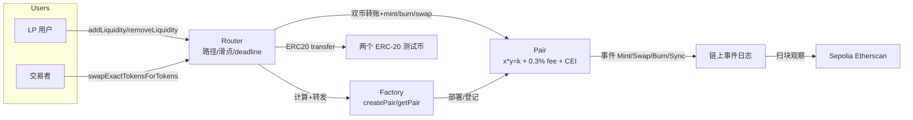

# SPEC-P3：Uniswap v2 风格 DEX Clone（自写 Factory/Pair/Router）

| 元信息 | 值 |
|---|---|
| 项目编号 | P3 |
| 所属阶段 | Phase 5（第 15-16 周） |
| 状态 | Draft → **Review** → Frozen（终审后冻结） |
| 版本 / 日期 | v1.0 / 2026-10-09 |
| 作者 | A5 |

## 1. 业务范围

一句话定位：一个部署在 Sepolia 测试网的恒定乘积 AMM DEX（Uniswap v2 风格），用户可创建交易对、注入流动性成为 LP、按 x·y=k 公式兑换代币；全部合约数学与业务逻辑自写（不 fork 官方源码），面向「能写能测能部署的合约工程能力」证明，同时是 DeFi 八股的实物素材。

核心业务流程（编号化，供第 5 节架构图对照）：
1. 创建交易对：用户调 Factory `createPair(tokenA, tokenB)` → 校验与排序（token0 < token1 按地址排序）→ 部署唯一 Pair，计入 allPairs 序列
2. 注入流动性：用户调 Router `addLiquidity` → 双币转入 Pair → `mint` 按 k 比例铸造 LP（首笔注销 MINIMUM_LIQUIDITY）→ 事件 + 返回 LP 数量
3. 兑换：用户调 Router `swapExactTokensForTokens` → 0.3% 手续费 → 恒定乘积公式算 amountOut（向下取整）→ k 约束校验 → 双币出账 → 事件
4. 移除流动性：用户调 Router `removeLiquidity` → 销毁 LP → 按份额取回双币（amountMin 滑点保护）
5. 失败路径（闭环必需）：滑点超限 / 超过 reserve / 双零输出 → revert 且状态回滚

## 2. 目标与边界

**Goals（本项目要做到的）**：
- G1：三件套自写实现，数学与逻辑 0 fork（对照 v2-core 只读语义与常数），验收①对照差异记录
- G2：Foundry 测试完备（单元 + fork + fuzz + invariant），覆盖率 ≥80%，fuzz 探测并修复 ≥1 边界 bug
- G3：Slither 静态扫描 medium+ 0 条 + 威胁模型文档（四资产攻击面表），验收③
- G4：Sepolia 真实部署 + Etherscan 源码验证 + 真实 swap 录屏，验收②⑤⑥
- G5：（弹性）React 前端（wagmi/viem）钱包交互完成一次 swap，验收加分项

**Non-Goals（明确不做，防止范围蔓延）**：
- NG1：不做闪电贷回调（swap 的 data 参数置空，文档声明；k 约束与 CEI 已覆盖重入面）
- NG2：不做价格预言机/时间加权均价（v2-core 的 priceCumulativeLast 不做；文档说明 AMM 价格不适合做预言机的理由）
- NG3：不做 fee-on-transfer 代币兼容（Router 直接 revert）
- NG4：不做多池路由寻优（path 由前端指定，Router 逐跳转发）
- NG5：不做链上治理 / Factory 升级；不做代币理财与无常损失对冲

## 3. NFR（非功能需求）

| 类别 | 指标 | 目标值 | 测量方式 |
|---|---|---|---|
| 正确性 | 舍入方向 | 所有给用户的金额向下取整，误差 ≥0 归池子 | 单元 + fuzz 断言 |
| 正确性 | k 不变式 | 任意 swap 序列后 x·y ≥ 初始 k（含手续费） | invariant 测试（foundry.toml 轮数 ≥1000） |
| 安全 | 重入面 | 恶意 token 回调时 reserve 已更新、k 校验拦截 | fork 测试 + 恶意 token 单测 |
| 安全 | 静态扫描 | Slither medium+ 0 条或逐条评估 | slither.txt 报告存档 |
| 可复现 | 部署 | forge script 一键幂等部署（.env.example 化） | docs/deploy.md 步骤实测 |
| 可观测 | CI | forge fmt --check + build + test + coverage 四步，最近 10 次 push 绿 | workflow + 截图 |

## 4. 技术栈（版本锁定）

| 组件 | 选型 | 版本 | 用途 | 备注 |
|---|---|---|---|---|
| 合约语言 | Solidity | 0.8.x（foundry.toml 锁定） | 三件套 | 不用 0.7 及更老语法 |
| 框架 | Foundry | 固定 tag（foundry.toml + CI 同版本） | 测试/部署/验证 | 脚手架：`../../scaffolds/foundry-project.md` |
| 测试库 | forge-std | 固定 tag 子模块 | 断言/作弊码 | 引入方式见脚手架 |
| 安全扫描 | Slither | pip 固定版本 | 静态分析 | 结果存 docs/security/ |
| 链 | Sepolia | — | 部署与验证 | 水龙头见 Phase 0 |
| 浏览器 | Sepolia Etherscan | — | 源码验证 | Verified 截图证据 |
| 前端（弹性） | React + wagmi/viem | 固定版本 | 钱包交互 | 加分项 |

约束：不引入 OpenZeppelin 的 ERC-20（测试代币自写最简 ERC-20）；不引入 Uniswap 官方源码文件（对照只读）。

## 5. 架构图（Mermaid）

**组件职责表**：
- Factory：交易对注册表；创建唯一 Pair（CREATE2 或 nonce 计数器，二选一并在 ADR 记录取舍）；只有它可 deploy Pair
- Pair：托管双币的池子；持有 reserve 快照；mint/burn/swap 三入口；CEI + k 约束
- Router：用户入口；路径拆解、滑点参数校验、deadline 校验；计算转发
- ERC-20（自写测试币）：仅用于 Sepolia 演示（如 MYA/MYB），无业务逻辑

**关键数据流**（对应第 1 节编号）：
- D1：流程 1：TR → Factory.createPair → PairCreated(pair) → 前端/测试记录地址
- D2：流程 2/4：LP → Router.addLiquidity → Pair.mint → LP 事件；逆流程 burn
- D3：流程 3：TR → Router.swapExactTokensForTokens → 逐 hop Pair.swap → Swap 事件 → 余额变化可见

## 6. 数据模型要点

- 核心状态变量（Pair）：
  - `reserve0/reserve1: uint112`（上限防溢出，getReserves 返回快照）
  - `totalSupply: uint256`（LP 代币总量，首笔注销 1000 锁零地址）
  - `token0/token1: address`（按地址排序固化，不可改）
  - `blockTimestampLast`（仅存时间戳，不做预言机）
- Factory：`mapping(pairKey => address) pairs`，pairKey = 排序后的 token0/token1 拼接；`allPairs: address[]`
- Router：无状态（纯转发 + 计算）；临时 approve 只在转账瞬间点对点存在
- 无 MySQL/Kafka 等链下组件；事件即持久化记录（对接 P1 心智：EVM 事件 logs 是链上审计源）

## 7. 里程碑 M1-M3

### M1：三件套合约（W15 第 6 天 - W16 第 2 天）
- 目标：Factory/Pair/Router 逻辑自写完成，核心数学（恒定乘积/手续费/舍入）全部自实现
- 关键任务：P05-06 骨架 → P03-T01 Pair 核心 → P03-T02 swap → P03-T03 Router（tasks 编号）
- 退出条件：
  - [ ] 仓库内执行 `forge build` 0 错误；`git log` 可见从空壳到完整逻辑的增量提交，无官方源码复制提交
  - [ ] `forge test` 通过且覆盖 getReserves/mint/burn/swap 的单元用例 ≥10 个（含 MINIMUM_LIQUIDITY、双零输出 revert、滑点 revert）

### M2：测试完备（W16 第 3-5 天）
- 目标：单元 + fork + fuzz + invariant 全绿；Slither 与威胁模型齐备
- 关键任务：P03-T04 fuzz/invariant → P03-T05 安全扫描/威胁模型/CI
- 退出条件：
  - [ ] `forge coverage` ≥80% 且截图入 README；fuzz 用例 ≥1000 轮 0 crash，docs/review.md 含 ≥1 条 fuzz 发现边界 bug 的修复记录
  - [ ] slither.txt 中 medium+ 0 条（或逐条评估）；docs/security/threat-model.md 四资产攻击面表完整

### M3：部署验证 + 录屏（W16 第 6 天）
- 目标：Sepolia 上链 + 源码验证 + 真实 swap 演示闭环
- 关键任务：P03-T07 部署/验证/录屏 → P03-T08 复盘/ADR/验收留痕
- 退出条件：
  - [ ] README「部署」节含 Factory/Pair/Router 三地址，Etherscan 三页 Verified，截图存 README
  - [ ] demo/ 下 3-10 分钟录屏（部署 → 加池 → swap → 失败 swap revert → 浏览器特写）配套 demo/script.md

## 8. 验收勾选表（引用 10 条标准明细）

> 判定细则见 `../../standards/project-acceptance-10.md`。

| # | 10 条标准 | 本项目判据（写完必须可勾选） | 证据位置 | 完成 |
|---|---|---|---|---|
| ① | 测试完备（≥80% + fuzz/边界） | `forge coverage` 全仓 ≥80%，关键包 Pair 路径 ≥90%（报告含包名数字）；fuzz ≥1000 轮 0 crash 且 review.md ≥1 条边界 bug 修复记录 | README「测试」节 + docs/review.md | [ ] |
| ② | 真实部署（testnet + 源码验证） | Factory/Pair/Router 三地址在 Sepolia，Etherscan 三页 Verified，截图存 README；docs/deploy.md 含 forge script 与 .env.example | README「部署」节 | [ ] |
| ③ | 安全自查（Slither/威胁模型） | docs/security/slither.txt 中 medium+ 0 条或逐条「已修复/已评估」；threat-model.md 覆盖重入/价格操纵/精度损失/approve 钓鱼 4 资产 | docs/security/ | [ ] |
| ④ | 文档齐备（Mermaid + ADR） | README 含本 SPEC 第 5 节同源 Mermaid 图；docs/adr/ ≥3 篇（含 1 篇中途换方案，如 CREATE2 vs nonce） | README + docs/adr/ | [ ] |
| ⑤ | 可演示（3-10 分钟录屏） | demo/ 录屏 3-10 分钟 + demo/script.md 分镜（三幕含失败路径） | demo/ | [ ] |
| ⑥ | 完整闭环（UI 或 CLI 走通全业务流） | 录屏或脚本输出可见：加池 → 成功 swap（余额变化 + tx 上链）→ 滑点超限 swap revert | demo/closed-loop 记录 | [ ] |
| ⑦ | 可复现（依赖锁死一键重跑） | foundry.toml 锁定版本 + forge-std 固定 tag；`git clone → cp .env.example .env → forge install/lib 校验 → forge build && forge script` 全新环境 ≤30 分钟跑通（时长记录入 README） | README「快速开始」 | [ ] |
| ⑧ | CI 自动化 | workflow 四步 forge fmt --check + build + test + coverage，覆盖率门禁 80%；最近 10 次 push 全绿截图 | .github/workflows/ci.yml + README「CI」 | [ ] |
| ⑨ | 复盘文档（踩坑 + 取舍） | docs/review.md ≥3 坑四要素 + ≥2 取舍对比表；每坑可改写 2 分钟面试故事 | docs/review.md | [ ] |
| ⑩ | 结果留痕（报告/地址/CI 截图） | README「成果清单」节：三地址（Verified）、覆盖率数字、CI 截图、录屏链接，验收当天全可打开 | README「成果清单」 | [ ] |

## 9. 周期估算与弹性

- 计划投入：2 周 × 6h/天；项目总人日估算 12 天（主课 Cyfrin 学习与项目时间并行，见 `../../05-defi-dex/tasks.md`）。
- 里程碑时间线：M1 截止 W16 第 2 天；M2 截止 W16 第 5 天；M3 截止 W16 第 6 天。
- 可砍条目（低档位适用，标「弹性」）：P05-07 Ethernaut 选做、P05-08 React 前端（弹性）；advanced Solidity 选讲（弹性）。红线：三件套自写（M1）、fuzz+Slither（M2）、部署+验证+录屏（M3）三个里程碑不可砍；P3 为软依赖项目（roadmap 第 4 节），但本阶段产出是 Phase 7「DeFi 八股」与项目深挖的素材源。

## 10. 演示脚本页（录屏步骤，最终成片 3-10 分钟）

| 幕 | 时长 | 操作 | 预期画面/数据 | 讲解要点 |
|---|---|---|---|---|
| 第 1 幕 部署 | ~2min | `forge script` 部署 Factory/Pair/Router（展示 .env 与命令） | 终端输出三地址 → Etherscan 打开验证页 | 部署链路 + 为什么源码验证 |
| 第 2 幕 主流程 | ~4min | MetaMask 注入测试币 → Router.addLiquidity → 成功 swap → 再试一笔小额 swap 看 0.3% 手续费 | 钱包余额变化 + Etherscan Swap 事件 | 恒定乘积公式、滑点、LP 份额 |
| 第 3 幕 特写 | ~2min | 播放一笔 amountOutMin 超限导致的 revert（cast send 或前端） | 终端 revert 错误串或前端 toast | 滑点保护 = 用户防 MEV 的第一道防线；顺带讲 k 约束与 CEI |
| 第 4 幕 收尾 | ~1min | `forge coverage` + Slither 摘要 + CI 绿 | 数字特写 | 测试与安全闭环 |

约束：录屏含讲解或字幕；总时长 3-10 分钟；与 README「演示」节链接同一文件。

## 11. 变更记录

| 版本 | 日期 | 变更 | 作者 |
|---|---|---|---|
| v1.0 | 2026-10-09 | 初稿 | A5 |